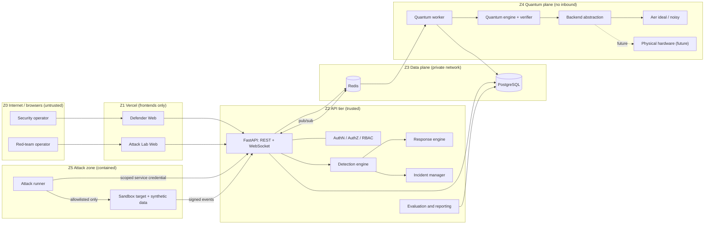
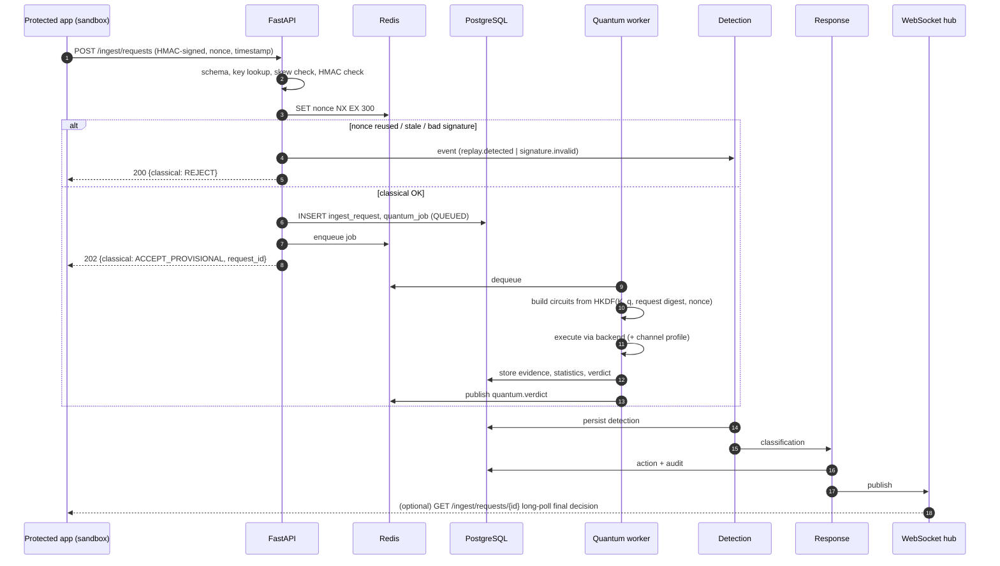
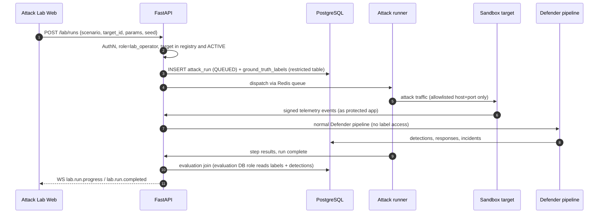
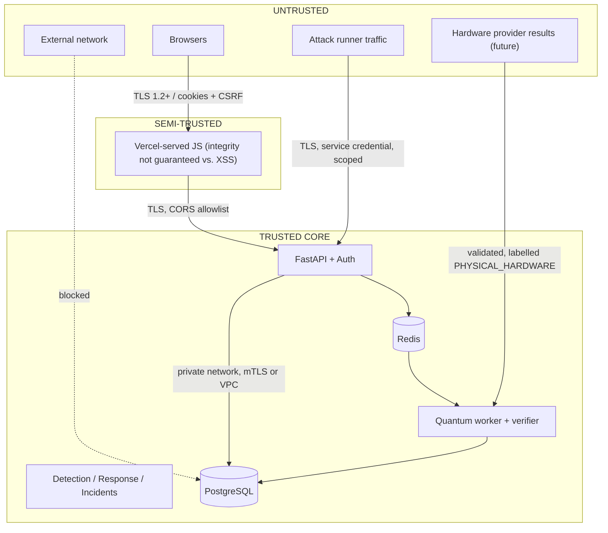
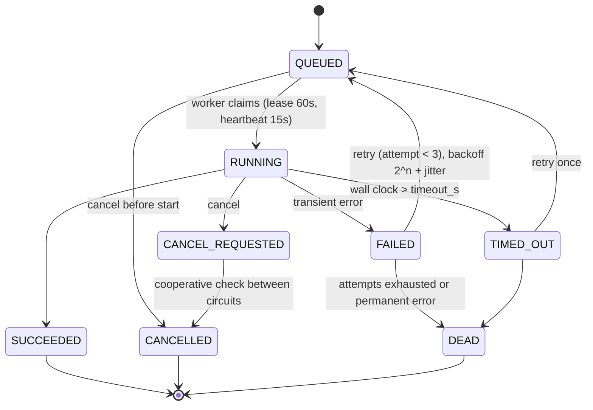
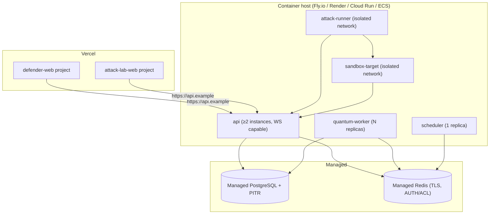

# QuantumShield — System Architecture

## 1. Design principles

| # | Principle | Consequence |
|---|---|---|
| P1 | **Fail closed** | Any verifier error, timeout, or `INCONCLUSIVE` verdict never results in implicit acceptance on `BLOCKING` resources. |
| P2 | **Quantum layer is additive** | Final decision = `classical_ok AND quantum_ok`. Quantum can add rejections; it can never rescue a classical rejection. |
| P3 | **Provenance on every quantum result** | `execution_kind`, backend id, noise-model hash, seed, library versions stored with each result. |
| P4 | **Sandbox-only offence** | Attack engine can only reach targets in the signed target registry. |
| P5 | **Ground-truth isolation** | Detection code cannot read attack labels. Only the evaluation service joins labels to detections. |
| P6 | **Idempotent asynchronous work** | Every job has an idempotency key; retries are safe. |
| P7 | **PostgreSQL is the source of truth** | Redis holds only ephemeral/derived state (queues, nonces, rate limits, pub/sub). Losing Redis loses no audit data. |

## 2. Component catalogue

| # | Component | Purpose | Technology | Trust zone |
|---|---|---|---|---|
| 1 | Defender frontend | Operator UI: overview, events, incidents, resources, quantum status, reports | Next.js + TS + Tailwind | Z1 (serves code, holds no secrets) |
| 2 | Attack Lab frontend | Experiment UI: scenarios, runs, batches, cancellation, reports | Next.js + TS + Tailwind | Z1 |
| 3 | FastAPI backend | Single API surface; AuthN/AuthZ, validation, orchestration, WebSocket gateway | FastAPI, Pydantic v2, SQLAlchemy 2, Alembic | Z2 |
| 4 | Authentication & authorization | Identities, sessions, RBAC, service credentials, request-signature verification | in-process module `backend/api/auth` | Z2 |
| 5 | Quantum engine | Circuit builders, backend abstraction, noise models, calibration | Qiskit, Qiskit Aer | Z4 (library used by worker; also imported by API for pure analytic maths only) |
| 6 | Quantum verification engine | Expected-distribution calculation, statistical tests, verdicts | NumPy/SciPy | Z4 |
| 7 | Attack simulation engine | Scenario runners (forgery, impersonation, replay, channel, web) | Python, httpx | Z5 (contained) |
| 8 | Detection engine | Rule + statistical classification of security events | Python | Z2 |
| 9 | Response engine | Policy-driven actions (flag, throttle, block, revoke, quarantine) | Python | Z2 |
| 10 | Incident management | Correlation of events into incidents, lifecycle, notes | Python + PostgreSQL | Z2 |
| 11 | Evaluation & reporting | Join detections with ground truth, compute metrics, reproducible reports | Python, pandas/SciPy | Z2 (separate DB role) |
| 12 | Quantum background worker | Executes quantum jobs from queue | Celery (prefork) + Redis | Z4 (no inbound ports) |
| 13 | PostgreSQL | Durable store, RLS, audit log | PostgreSQL 16 | Z3 |
| 14 | Redis | Broker, nonce cache, rate-limit buckets, pub/sub | Redis 7 | Z3 |
| 15 | WebSocket infrastructure | Real-time push to Defender and Lab | FastAPI WebSocket + Redis pub/sub | Z2 |
| + | Sandbox target app | Deliberately vulnerable synthetic app for conventional tests | small FastAPI/Next app | Z5 |

**Chosen queue technology:** Celery with the prefork pool (Qiskit simulation is CPU-bound; a prefork pool sidesteps the GIL and the asyncio event loop). `acks_late=True`, `task_reject_on_worker_lost=True`, one job per process at a time (`prefetch_multiplier=1`). PostgreSQL `quantum_jobs` is authoritative; Celery task ids are an implementation detail.

## 3. System architecture diagram



## 4. Component responsibility matrix

Legend: **E** = enforces / owns, **U** = uses, blank = not responsible.

| Component | Owns data | AuthN | AuthZ | Input validation | Emits events | Runs quantum | Writes audit log |
|---|---|---|---|---|---|---|---|
| Defender web | — | U (session) | U (UI hiding only, not security) | client-side UX only | — | — | — |
| Attack Lab web | — | U | U (UI only) | UX only | — | — | — |
| FastAPI gateway | request logs | **E** | **E** | **E** (Pydantic) | **E** | — | **E** |
| Auth module | users, sessions, credentials | **E** | **E** | **E** | **E** | — | **E** |
| Quantum engine/verifier | calibrations, evidence | — | — | **E** (circuit params) | **E** | **E** | U |
| Quantum worker | job results | U (job token) | — | U | **E** | **E** | U |
| Attack engine | run steps | U (service cred.) | U (target allowlist) | — | **E** | U | U |
| Detection engine | detections | — | — | — | **E** | — | U |
| Response engine | response actions | — | **E** (action policy) | — | **E** | — | **E** |
| Incident manager | incidents | — | U | **E** | **E** | — | **E** |
| Evaluation | reports, labels (read) | — | **E** (own DB role) | — | **E** | U | **E** |
| PostgreSQL | everything durable | **E** (roles) | **E** (RLS) | **E** (constraints) | — | — | **E** (append-only) |
| Redis | ephemeral | **E** (ACL + TLS) | — | — | — | — | — |

## 5. Data flow

### 5.1 Protected request verification (two-phase decision)



**Enforcement modes per protected resource**
- `BLOCKING`: the protected app waits (long-poll, default timeout 5 s) for the final verdict. Timeout ⇒ **reject** (P1).
- `MONITOR`: the app proceeds on the provisional classical decision; the Defender raises detections and responses asynchronously.

### 5.2 Attack Lab run



### 5.3 Data ownership

| Store | Written by | Read by | Notes |
|---|---|---|---|
| `security_events`, `detections`, `incidents`, `response_actions` | API, Detection, Response | Defender UI, Evaluation | `attack_run_id` is **not** a column here (P5). |
| `attack_runs`, `attack_run_steps` | Attack runner via API | Lab UI, Evaluation | |
| `ground_truth_labels` | API (on run creation) | **Evaluation role only** | Detection DB role has no `SELECT`. |
| `quantum_jobs`, `quantum_evidence`, `calibrations` | API, worker | Defender UI, Evaluation | |
| `audit_log` | all (via trigger/service) | Admin/auditor | append-only, hash-chained |

Correlation between Defender observations and an attack run is done by the evaluation service via the synthetic **`sandbox_session_id`** and time windows — the same information a real defender would have only after the fact.

## 6. Trust boundaries



| Boundary | Crossing rules |
|---|---|
| Z0 → Z1/Z2 | TLS only; HSTS; all input untrusted; strict schema validation; rate limits. |
| Z1 → Z2 | CORS allowlist (exact origins); cookie auth with CSRF token; WebSocket via one-time ticket. |
| Z2 → Z3 | Least-privilege DB roles (`qs_api`, `qs_worker`, `qs_eval`, `qs_migrator`); Redis ACL users per component. |
| Z2/Z3 → Z4 | Worker pulls from queue; no inbound listener; job payloads validated again in worker. |
| Z5 → Z2 | Attack runner holds a *scoped* service credential (`lab:run`), can only call lab and ingest endpoints for registered sandbox links. |
| Z5 → anywhere else | Egress firewall: only API and registered sandbox hosts. Anything else is dropped and alerted. |
| Z4 → future hardware provider | Results are untrusted input: validated, size-capped, and stored with `execution_kind=PHYSICAL_HARDWARE` only if a provider job id is present. |

**Trusted:** API, auth module, detection, response, incident manager, evaluation, worker, PostgreSQL, Redis.
**Untrusted:** browsers, all request bodies, Attack Lab traffic content, the sandbox app, simulated "attacker" operations inside circuits, any future hardware provider output.

## 7. Where AuthN and AuthZ are enforced

| Concern | Enforcement point | Mechanism |
|---|---|---|
| Human login | `POST /auth/login` | Argon2id password check, rate limit, optional TOTP |
| Human session | FastAPI dependency `require_session` on every router | HttpOnly cookie → server-side session row |
| RBAC | FastAPI dependency `require_role(...)` + route-level scope decorators | Role→permission table (see security doc §3) |
| Data-level AuthZ | PostgreSQL RLS keyed on `app.current_org_id` set per request | `SET LOCAL` in the transaction |
| Machine identities (protected apps) | `ingest` router | HMAC request signature (key id + nonce + timestamp) |
| Attack runner | `lab` router | Service JWT, `aud=lab-runner`, scope `lab:run`, 15-minute TTL |
| Lab target scope | Attack engine **and** API | Target registry check twice (defence in depth) |
| WebSocket | Handshake | One-time ticket (30 s TTL) bound to user, org, and channel set |
| Quantum worker | Job claim | Worker authenticates to Redis/PG with its own role; job payload carries `org_id` |

The frontends perform **no** security decisions. Hiding a button is UX only.

## 8. Quantum job lifecycle and long-running work



Rules:
1. **Idempotency:** `UNIQUE(org_id, idempotency_key)`. Re-submitting returns the existing job.
2. **Chunking:** a job is a list of circuits. The worker executes in chunks (≤ 8 circuits or ≤ 20 s) and checks the cancel flag (`Redis GET job:{id}:cancel`) and the lease between chunks. Partial results are persisted after each chunk.
3. **Timeouts:** soft limit raises `SoftTimeLimitExceeded` (cleanup, persist partials); hard limit kills the child process. Defaults: verification job 30 s, calibration 300 s, teleportation tomography 120 s.
4. **Lease & recovery:** a janitor (Celery beat, every 30 s) re-queues `RUNNING` jobs whose heartbeat is older than the lease. Because of idempotent writes (`ON CONFLICT DO NOTHING` on `(job_id, circuit_index)`), double execution is harmless.
5. **Retry policy:** only transient classes (`BackendUnavailable`, `ConnectionError`, `SoftTimeLimitExceeded`) retry. `ValidationError`, `ShotBudgetExceeded`, `ProvenanceViolation` are permanent.
6. **Back-pressure:** per-org queued-job cap (default 200) → `429`. Shot budget per job (default 200 000 shots) is enforced in API and worker.
7. **Determinism:** each circuit gets `seed_simulator` = `uint32(HKDF(job_seed, circuit_index))`; stored with the result.

## 9. Real-time updates

**Mechanism:** one WebSocket endpoint `GET /ws/v1/stream?ticket=…`; server fan-out via Redis pub/sub channels.

1. Client calls `POST /api/v1/ws/tickets {channels:[…]}` (authenticated, CSRF-protected). Server stores `ticket → {user, org, channels}` in Redis with TTL 30 s, single use.
2. Client opens the WebSocket with the ticket (browsers cannot set `Authorization` on WebSocket).
3. Server validates the `Origin` header against the allowlist, consumes the ticket, subscribes to `org:{org_id}:{channel}`.
4. Every message is an **envelope** (see API doc §6) with monotonic `seq` per channel. Delivery is *at-least-once, in order per channel*.
5. On reconnect the client sends `last_seq`; the server replays from `GET /events?after_seq=` if the gap is ≤ 1 000 events, otherwise instructs a full refresh.
6. Heartbeat: server `ping` every 20 s; two missed pongs ⇒ close. Backpressure: per-connection send queue ≤ 500 messages; overflow ⇒ close with code 1013 and client resyncs via REST.
7. Authorization is re-checked every 5 minutes (session revoked ⇒ close 4401).

Channels: `events`, `incidents`, `quantum`, `responses`, `lab.runs`, `system`.

## 10. How Attack Lab results reach the Defender

There are **two distinct data paths** and they are intentionally separate:

1. **Telemetry path (what the Defender sees):** the sandbox target behaves like any protected application and sends signed ingest requests and security events. The Defender processes these exactly like production traffic. The Defender has no knowledge a run is synthetic beyond the `resource.is_sandbox=true` flag (needed for safety, not detection).
2. **Evaluation path (what the Lab knows):** the Lab records its actions and ground-truth labels in `attack_runs`/`ground_truth_labels`. After completion the Evaluation service joins labels with Defender detections within `[run.started_at − 1 s, run.finished_at + 30 s]` for the same `sandbox_session_id`.

The Defender UI shows *Defender-observed* data live, plus a read-only "Lab experiment" panel (run summary, detection effectiveness) that is populated only after evaluation.

## 11. Failures and retries

| Failure | Detection | Handling | User-visible effect |
|---|---|---|---|
| Quantum worker crash | heartbeat timeout | janitor re-queues, attempt+1 | job stays `RUNNING→QUEUED`; event `quantum.job.retried` |
| Backend unavailable | exception class | exponential backoff, ≤ 3 attempts, then `DEAD` | verdict `INCONCLUSIVE`; `BLOCKING` resources reject |
| Calibration stale (> 24 h, or drift test fails) | verifier precondition | verdict `INCONCLUSIVE` + calibration job auto-queued | banner in Defender |
| Redis down | health check, connection errors | API returns `503` for ingest on `BLOCKING` resources; replay protection **cannot** degrade silently → reject | health page red |
| PostgreSQL down | health check | `503`; no writes accepted; ingest rejects | |
| WebSocket drop | missed pong | client exponential reconnect (1 s→30 s) + resync | "live" indicator off |
| Attack runner crash | run heartbeat | run → `FAILED`, sandbox state reset job queued | Lab shows failure reason |
| Poison job | `DEAD` after 3 attempts | dead-letter table, alert | Admin queue view |

Retries never re-send side-effectful HTTP attack steps blindly: attack steps are individually idempotent by `(run_id, step_index)` and the runner records completion before advancing.

## 12. Deployment architecture



- **Domains:** `defender.<domain>`, `lab.<domain>`, `api.<domain>` — all same-site, so `SameSite=Lax` cookies work with `credentials: "include"` and WebSockets are served by the API host (Vercel cannot host the WebSocket server).
- **Environments:** `local` (docker-compose), `staging`, `prod`. Staging and prod never share databases or secrets.
- **docker-compose services:** `api`, `worker`, `beat`, `postgres`, `redis`, `attack-runner`, `sandbox-target`, optional `defender-web`, `lab-web` for local dev.
- **Network:** attack-runner and sandbox-target on a Docker network `qs-lab` with `internal: true` plus one explicit route to `api`.
- **CI:** GitHub Actions: lint, type-check, unit tests, quantum tests (seeded), OpenAPI export, TS client generation, container build. Vercel deploys from `apps/*` only.
- **Secrets:** environment variables from the platform secret store; never in the repo; `.env.example` has names only.

## 13. Monorepo structure (adapted)

Changes versus the proposed layout: added `packages/` (generated API client and shared types), `backend/common`, `sandbox/`, `workers/attack_runner`, and `docs/development`.

```text
quantumshield/
├── apps/
│   ├── defender-web/              # Next.js (App Router) + TS + Tailwind
│   └── attack-lab-web/
├── packages/
│   ├── api-client/                # generated from OpenAPI (openapi-typescript)
│   └── ui/                        # shared Tailwind components, minimal
├── backend/
│   ├── api/                       # FastAPI app, routers, auth, ws
│   ├── common/                    # settings, logging, ids, errors, enums
│   ├── quantum_engine/            # circuits, backends, noise, calibration, verify
│   ├── attack_engine/             # scenarios, safety guard, runner library
│   ├── detection/
│   ├── response/
│   ├── incidents/
│   └── evaluation/
├── workers/
│   ├── quantum_worker/            # Celery app + tasks
│   └── attack_runner/             # process hosting attack_engine
├── sandbox/
│   └── target_app/                # deliberately vulnerable synthetic app
├── infrastructure/
│   ├── docker/
│   └── database/                  # alembic/, init SQL, RLS policies, roles
├── docs/{architecture,quantum,security,api,evaluation,development}/
├── tests/{unit,integration,quantum,e2e,security}/
├── docker-compose.yml
├── pyproject.toml                 # uv or poetry, one lockfile
├── README.md
└── .gitignore
```

## 14. Acceptance criteria for the architecture

| ID | Criterion |
|---|---|
| ARC-1 | Every component in §2 appears as a package/service in the repo with a README stating its trust zone. |
| ARC-2 | No frontend code path performs an authorization decision that is not also enforced server-side (verified by API tests with a user of insufficient role). |
| ARC-3 | Detection DB role cannot `SELECT` from `ground_truth_labels` (integration test asserts permission error). |
| ARC-4 | Killing the worker mid-job results in the job completing after lease expiry with no duplicate result rows. |
| ARC-5 | With Redis stopped, `BLOCKING` resource ingest returns a rejection and a `system.degraded` event; it never accepts. |
| ARC-6 | WebSocket reconnect after a 10-second network cut delivers every missed event exactly once to the UI state (client dedup by `seq`). |
| ARC-7 | Attack runner cannot connect to any host outside the registry (network test: connection to `example.com` and to a non-registered local port fails and raises `lab.safety.violation`). |
| ARC-8 | All quantum results in API responses include `backend.execution_kind`. A schema test fails if the field is absent. |
