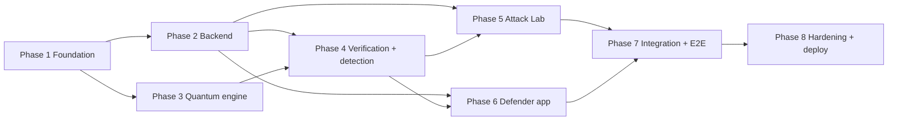

# QuantumShield — Antigravity Implementation Backlog

**Document status:** Plan v1.0, written before any code exists.
**Nothing in this document has been implemented or tested.** The GitHub repository does not exist yet; creating it is task `P1-01`. All commands, snippets, versions and file lists are *instructions to be executed and verified by Antigravity*.

**Relationship to earlier documents.** This file operationalises:
`architecture/system-architecture.md` (ARC-*), `quantum/quantum-protocol-spec.md` (Q-*), `security/hybrid-security-architecture.md` (SEC-*), `security/attack-lab-methodology.md` (LAB-*), `api/api-contracts-and-schema.md` (API-*), `evaluation/detection-and-evaluation.md` (EVAL-*). It **supersedes the story list and sequencing** in `development/backlog-risks-review.md` (whose risk register, review checklist and open decisions remain valid). Where this file and an earlier spec disagree, stop and raise an ADR (§2.5); do not silently pick one.

**Gap notice.** Earlier deliverables did not include a standalone *frontend specification* or *testing strategy*. They are provided here as **Appendix A** and **Appendix B**.

---

## 1. Division of responsibilities (realistic)

| Area | Claude (architecture/research/review) | Antigravity (implementation) | Joint / owner decision |
|---|---|---|---|
| Repository | Defines layout and conventions | **Creates repo, monorepo, CI, branch protection** | Repo name, visibility, license |
| Specs | Authors and maintains docs under `docs/`; answers spec questions; updates specs when an ADR is accepted | Implements specs; raises ADRs when a spec is ambiguous or wrong | Accepts ADRs |
| Backend | API contracts, DB design, security model, review criteria | FastAPI, SQLAlchemy, Alembic, Celery, tests | Hosting choice |
| Quantum | Protocol maths, derivations, statistics, thresholds, test vectors, scientific review | Qiskit/Aer code, tests; **verifies every Qiskit API name/behaviour against the pinned version** | Hardware roadmap |
| Detection/response | Rule semantics, fusion, policy matrix | Code + unit tests with ≥10 pos/neg cases per rule | Response aggressiveness |
| Attack Lab | Scenario design, safety rules, pass/fail criteria | Runner, sandbox app, payload corpora, network isolation | Authorisation to run labs |
| Frontend | Page/behaviour spec (Appendix A), security UI rules | Next.js apps, components, tests | Branding/design taste |
| Evaluation | Metrics, statistics, experiment design, report template | Evaluation service, report generator | Which experiments to publish |
| Testing | Strategy, tolerances, review of test adequacy | Writes and runs all tests, owns CI | — |
| Deployment | Deployment architecture, secrets model | Dockerfiles, Vercel/container deployment, runbooks | Accounts, domains, billing |
| Review | Reviews PRs/diffs/test output pasted into the chat against checklists; reports spec defects | Opens PRs, responds to review, keeps CI green | Final merge authority |

**Claude does not:** create or commit to the repository, run code, deploy, or claim test results. **Antigravity does not:** change security semantics (fail-closed, provenance, ground-truth isolation) without an accepted ADR, or write a parallel spec.

**Review loop.** At the end of each phase (and any time a task is blocked) Antigravity sends Claude: (1) PR links or diffs, (2) CI output, (3) a filled *Task Report* (§2.4). Claude replies with defects classified `BLOCKER / MAJOR / MINOR` against the acceptance criteria and the review checklist in `backlog-risks-review.md §4`.

---

## 2. Working agreements

### 2.1 Priorities
`P0` critical path (blocks others) · `P1` required for MVP · `P2` stretch/after MVP.

### 2.2 Branching and commits
- `main` protected: PR required, ≥1 approval, CI green, linear history (squash merge).
- Branch names: `phase-N/<task-id>-short-name`, e.g. `phase-2/P2-05-signing`.
- Conventional Commits (`feat:`, `fix:`, `test:`, `docs:`, `chore:`), one logical change per commit; task ID in the PR title.
- Never commit secrets, `.env`, `*.pem`, real data. `.env.example` has names and safe dummy values only.

### 2.3 Global Definition of Done (applies to **every** task; task-level DoD adds to it)
1. Code merged to `main` through a PR that references the task ID and its acceptance criteria.
2. All **Required automated tests** of the task exist and pass **in CI** (not only locally).
3. Linters/type checks pass: `ruff check`, `ruff format --check`, `mypy --strict backend/` (new code), `eslint`, `tsc --noEmit`.
4. No new Semgrep/gitleaks findings.
5. Public behaviour changes are reflected in OpenAPI and, if they deviate from `docs/`, in an ADR + doc patch.
6. Every quantum result path preserves `backend.execution_kind` (Quantum §10).
7. Task Report filled and attached to the PR.
8. No `TODO` without a linked issue; no `TODO(security)` at all.

### 2.4 Task Report template (paste into PR)
```markdown
**Task:** P?-??  **PR:** #  **Commit range:**
**What was done:** (3–6 bullets)
**Files created/modified:** (list)
**Acceptance criteria:** ID → PASS/FAIL (+ CI job link or test name)
**Tests added:** (paths)
**Deviations from spec:** (none | ADR-###)
**Known gaps / follow-ups:** (issue links)
**Versions pinned/changed:** (qiskit, qiskit-aer, python, node …)
```

### 2.5 ADR process
Create `docs/development/adr/ADR-NNN-title.md` (Context, Decision, Consequences, Status). Required for: any dependency major-version choice that affects specs (Qiskit/Aer/Celery/Next), any deviation from specs, any weakening of a security control. `ADR-001` (task `P1-03`) records chosen runtime/library versions.

### 2.6 Conventions used below
- **Files** lists exact paths to create (C) or modify (M). Paths are relative to repo root.
- **Tests** lists the *minimum* required automated tests; more are welcome.
- `Depends` lists prerequisite task IDs; start a task only when all are Done.

---

## 3. Phase map

| Phase | Name | Tasks | Exit gate |
|---|---|---|---|
| 1 | Repository & monorepo foundation | P1-01 … P1-08 | CI green on empty skeleton; compose up healthy |
| 2 | FastAPI backend foundation | P2-01 … P2-10 | ARC-2/3, SEC-1…5, API-1…8 (backend part) pass |
| 3 | Qiskit/Aer quantum engine | P3-01 … P3-08 | Q-1…Q-9, Q-13…Q-15 pass |
| 4 | Quantum verification & detection | P4-01 … P4-08 | Q-10…Q-12, EVAL-1…3, SEC-2/3 pass |
| 5 | Isolated Attack Lab | P5-01 … P5-09 | LAB-1…7 pass |
| 6 | Defender application | P6-01 … P6-07 | EVAL-8, SEC-8, UI tests pass |
| 7 | Integration & end-to-end | P7-01 … P7-07 | ARC-4…7, EVAL-5, Scenarios 1–5 e2e pass |
| 8 | Hardening & deployment | P8-01 … P8-08 | All *-N criteria pass on staging; release checklist signed |


Phases 2 and 3 run in parallel after Phase 1; Phase 6 UI work can start against mocked API once `P2-10` (OpenAPI/TS client) is done.

---

## 4. Day 2 plan (tomorrow) — execute in order

**Goal for Day 2:** Phase 1 complete; Phase 2 foundations (`P2-01`, `P2-02`, `P2-03`) merged; `P2-05` (signing) and `P3-01`/`P3-02` started or done if time allows. Each step ends with a commit; each numbered block ends with its checkpoint.

| Step | Task | Action | Checkpoint (must be true before moving on) |
|---|---|---|---|
| D2-01 | P1-01 | Create GitHub repo `quantumshield` (private), default branch `main`; enable secret scanning, push protection, Dependabot alerts | Repo URL exists; empty `main` with initial README commit |
| D2-02 | P1-01 | Configure branch protection on `main` (PR required, 1 approval, status checks to be added after CI exists, linear history) | Settings screenshot/notes in Task Report |
| D2-03 | P1-02 | Copy the 8 delivered docs into `docs/` with identical paths; add root files (`README.md`, `.gitignore`, `.editorconfig`, `.env.example`, `SECURITY.md`, `CONTRIBUTING.md`, `CODEOWNERS`) | `docs/**` tree matches delivered tree; PR merged |
| D2-04 | P1-03 | Create Python workspace (`pyproject.toml`, package skeletons, tool configs, `Makefile`); pick and **record** Python/Qiskit/Aer versions in ADR-001 | `make lint typecheck test` runs (zero tests collected is acceptable only until D2-07) |
| D2-05 | P1-04 | Create JS workspace and both Next.js apps + packages | `pnpm install && pnpm -r build` succeeds |
| D2-06 | P1-05 | docker-compose with `postgres`, `redis` | `docker compose up -d --wait` → healthy; `pg_isready` and `redis-cli ping` succeed |
| D2-07 | P1-08 | Smoke tests (Python + JS) | `make test` and `pnpm -r test` green locally |
| D2-08 | P1-06, P1-07 | CI workflow, Semgrep rules, gitleaks, pre-commit | First CI run green on a PR; add required status checks to branch protection |
| D2-09 | P2-01 | `backend/common` (settings, logging redaction, errors, enums) + tests | Unit tests green; enum test compares with API doc §1 list |
| D2-10 | P2-02 | FastAPI app factory, middleware, health | `GET /api/v1/health` 200 in test; headers test green |
| D2-11 | P2-03 | SQLAlchemy models + Alembic baseline + roles/RLS SQL | `alembic upgrade head` on fresh DB; API-4/API-5 tests green |
| D2-12 | P3-01 | Quantum backend abstraction + provenance validators (pure Python, no web) | Q-13 tests green |
| D2-13 | P3-02 (stretch) | State prep/basis rotation/analytic expectations + counts parser | Q-1, Q-14 green; Q-2/Q-3 if time |
| D2-14 | — | Fill **Day 2 report** (below) and send to Claude with PR links + CI output | Report delivered |

**Day 2 report format (send to Claude):** tasks completed (IDs), CI links, pinned versions (from ADR-001), deviations, blockers, questions. If any of D2-01…D2-08 is incomplete, do **not** start D2-09+; finish the foundation first.

**Day 3 preview:** `P2-04`, `P2-05`, `P2-06`, `P3-03…P3-05`, then `P2-07…P2-10`.

---

## 5. Phase 1 — GitHub repository and monorepo foundation

### P1-01 — Create the GitHub repository  `P0`  Depends: —
- **Files:** none in repo (GitHub settings). Record decisions in `docs/development/adr/ADR-000-repo-setup.md` (C).
- **Instructions:**
  1. Create private repo `quantumshield` under the owner's account/org. Default branch `main`.
  2. Settings → Code security: enable Dependabot alerts + security updates, secret scanning, push protection.
  3. Protect `main`: require status checks (added in P1-06), require linear history, block force-push and deletion. Require a pull request. Set one approving review only when at least two eligible maintainers are available; for a solo-maintainer project, use a documented self-review/checklist process rather than creating an impossible merge gate.
  4. Enable "Automatically delete head branches". Create labels `P0,P1,P2,phase-1…phase-8,blocker,adr,security`.
  5. Create a GitHub Project board with the phase columns; create one issue per task ID (title = ID + name) — optional but recommended.
- **Acceptance:** repo exists; protection rules active (pushing directly to `main` is refused); secret scanning on.
- **Required tests:** manual verification checklist in the Task Report (attempt a direct push to `main` and show refusal).
- **DoD:** global DoD items 1, 7 (N/A for code) + settings evidenced.

### P1-02 — Import documentation and root files  `P0`  Depends: P1-01
- **Files (C):** `docs/architecture/system-architecture.md`, `docs/quantum/quantum-protocol-spec.md`, `docs/security/hybrid-security-architecture.md`, `docs/security/attack-lab-methodology.md`, `docs/api/api-contracts-and-schema.md`, `docs/evaluation/detection-and-evaluation.md`, `docs/development/backlog-risks-review.md`, `docs/development/antigravity_implementation_backlog.md`, `docs/frontend/application-specification.md`, `docs/testing/testing-strategy.md`; root `README.md`, `.gitignore`, `.editorconfig`, `.env.example`, `SECURITY.md`, `CONTRIBUTING.md`, `CODEOWNERS`, `docs/development/adr/.gitkeep`.
- **Instructions:**
  - Import all ten supplied Markdown documents into the exact paths listed above. Keep `README.md` at the repository root; do not require or link to `docs/README.md` unless a separate documentation index is deliberately created.
  - Root `README.md`: project one-liner, the honesty statement (quantum layer is additive/experimental; does not secure HTTP/DB), quick-start placeholder, links to the architecture, quantum, security, API, evaluation, frontend, testing and development documents.
  - `.gitignore`: Python (`__pycache__`, `.venv`, `.mypy_cache`, `.ruff_cache`, `.pytest_cache`, `htmlcov`), Node (`node_modules`, `.next`, `.turbo`, `dist`), env (`.env`, `.env.*` except `.env.example`), IDE, OS, `*.pem`, `*.key`, `artifacts/`.
  - `.env.example` variable names (values dummy): `QS_ENV`, `DATABASE_URL`, `REDIS_URL`, `QS_DEV_KEK`, `SESSION_COOKIE_DEFENDER`, `SESSION_COOKIE_LAB`, `ALLOWED_ORIGINS`, `API_PUBLIC_URL`, `LAB_ENABLED`, `CELERY_BROKER_URL`, `SIGNING_SKEW_SECONDS=60`, `NONCE_TTL_SECONDS=300`.
  - `SECURITY.md`: how to report vulnerabilities; scope statement incl. "Attack Lab targets only registered sandboxes".
  - `CODEOWNERS`: `/docs/ @owner`, `/backend/quantum_engine/ @owner`, `/backend/api/auth/ @owner` (placeholders replaced with real handles).
- **Acceptance:** doc tree identical to delivery (checksum list in report); gitleaks clean; no real secrets.
- **Tests:** CI check `scripts/check_docs_links.py` (C) verifying relative links in `docs/**/*.md` resolve (added in P1-06 and run in CI).
- **DoD:** global.

### P1-03 — Python workspace and tooling  `P0`  Depends: P1-02
- **Files (C):** `pyproject.toml`, `Makefile`, `.python-version`, `backend/__init__.py`, `backend/{api,common,quantum_engine,attack_engine,detection,response,incidents,evaluation}/__init__.py`, `workers/quantum_worker/__init__.py`, `workers/attack_runner/__init__.py`, `sandbox/target_app/__init__.py`, `tests/{unit,integration,quantum,e2e,security}/__init__.py`, `tests/conftest.py`, `docs/development/adr/ADR-001-runtime-and-versions.md`.
- **Instructions:**
  1. Use one lockfile (`uv` preferred; Poetry acceptable). Python ≥ 3.11.
  2. Runtime deps (pin exact versions after resolving; record in ADR-001): `fastapi`, `uvicorn[standard]`, `pydantic>=2`, `pydantic-settings`, `sqlalchemy>=2`, `alembic`, `psycopg[binary,pool]` (v3), `redis`, `celery`, `argon2-cffi`, `pyotp`, `cryptography`, `httpx`, `numpy`, `scipy`, `qiskit`, `qiskit-aer`, `structlog`, `orjson`, `python-multipart` (only if needed).
  3. Dev deps: `pytest`, `pytest-asyncio`, `pytest-cov`, `hypothesis`, `pytest-timeout`, `ruff`, `mypy`, `semgrep`, `pre-commit`, `openapi-spec-validator`.
  4. `pyproject.toml`: `ruff` (line-length 100, rules `E,F,I,UP,B,S,C4,SIM`), `mypy` strict for `backend/`, `pytest` markers `unit,integration,quantum,slow,e2e,security`, `asyncio_mode=auto`, default `-m "not slow"`.
  5. `Makefile` targets: `install, lint, format, typecheck, test, test-slow, up, down, migrate, openapi, clean`.
  6. **In ADR-001 record the exact Qiskit and Aer versions and confirm the following APIs exist in them:** `QuantumCircuit.if_test`, `qiskit_aer.AerSimulator`, `qiskit_aer.noise.{NoiseModel,pauli_error,depolarizing_error,ReadoutError}`, `transpile`. If any differ from the spec fragments in Quantum spec, record the replacement and notify Claude.
- **Acceptance:** `make install lint typecheck test` succeeds from a clean clone; ADR-001 lists versions and API verification results.
- **Tests:** `tests/unit/test_imports.py` imports every package; `tests/quantum/test_qiskit_api_present.py` asserts the APIs above exist (marker `quantum`).
- **DoD:** global + ADR-001 merged.

### P1-04 — JavaScript workspace and Next.js apps  `P0`  Depends: P1-02
- **Files (C):** `package.json`, `pnpm-workspace.yaml`, `.nvmrc`, `tsconfig.base.json`, `apps/defender-web/**`, `apps/attack-lab-web/**`, `packages/api-client/{package.json,tsconfig.json,src/index.ts}`, `packages/ui/{package.json,src/index.ts}`, `.eslintrc.cjs` (or flat config), `.prettierrc`.
- **Instructions:**
  1. Node LTS pinned in `.nvmrc`; pnpm workspace.
  2. Generate each app with Next.js App Router, TypeScript, Tailwind, ESLint, `src/` dir; `"strict": true`, `noUncheckedIndexedAccess: true`.
  3. App names/ports: defender-web `3000`, attack-lab-web `3001`.
  4. Add Vitest + React Testing Library to both apps; Playwright at repo root `e2e/` later (P7).
  5. `packages/api-client` will hold generated types (P2-10); `packages/ui` minimal shared primitives (Badge, Table, Card) — keep tiny.
  6. Each app has `src/app/layout.tsx`, `src/app/page.tsx` placeholder showing app name and the text "Quantum results always display their execution kind".
- **Acceptance:** `pnpm install --frozen-lockfile && pnpm -r build && pnpm -r lint && pnpm -r test` pass.
- **Tests:** one render test per app (page renders heading).
- **DoD:** global.

### P1-05 — Docker Compose dev stack  `P0`  Depends: P1-03
- **Files (C):** `docker-compose.yml`, `infrastructure/docker/postgres/init/00-roles.sql` (placeholder, filled in P2-03), `infrastructure/docker/redis/redis.conf`, `.env.example` (M).
- **Instructions:** services `postgres:16` (healthcheck `pg_isready`), `redis:7` (healthcheck `redis-cli ping`, `requirepass` from env, `appendonly no` for dev). Named volumes. Networks: `qs-core` now; `qs-lab` (`internal: true`) declared for P5. No ports published except `5432`/`6379` bound to `127.0.0.1`.
- **Acceptance:** `docker compose up -d --wait` → all healthy within 60 s; `docker compose down -v` cleans.
- **Tests:** `tests/integration/test_compose_services.py` (marker `integration`) connects to Postgres and Redis using env URLs and executes `SELECT 1` / `PING`.
- **DoD:** global.

### P1-06 — CI pipeline  `P0`  Depends: P1-03, P1-04, P1-05
- **Files (C):** `.github/workflows/ci.yml`, `.github/dependabot.yml`, `.github/pull_request_template.md` (Task Report template), `scripts/check_docs_links.py`.
- **Instructions:** jobs: `python` (service containers postgres/redis; `uv sync`; ruff, mypy, pytest `-m "not slow"` with coverage artefact), `quantum` (pytest `-m quantum`, separate job for timing), `web` (pnpm install/lint/tsc/test/build), `security` (Semgrep with `.semgrep/`, gitleaks), `docs` (link check). Cache dependencies. Required status checks = all jobs. Use least-privilege `permissions:` and pin third-party actions by commit SHA.
- **Acceptance:** a PR with a trivial change triggers all jobs green; a PR containing a fake secret (`AKIA…` pattern test string) is blocked by gitleaks (demonstrate then discard).
- **Tests:** CI itself; `tests/unit/test_docs_links.py` runs the link checker on a fixture.
- **DoD:** global + branch protection updated to require the jobs.

### P1-07 — Security tooling baseline  `P1`  Depends: P1-06
- **Files (C):** `.semgrep/qs-rules.yml`, `.gitleaks.toml`, `.pre-commit-config.yaml`.
- **Instructions:** Semgrep rules (error severity): f-string/concat/`%`/`.format` inside `text(`, `execute(`; `eval`, `exec`, `pickle.loads`, `yaml.load` without SafeLoader, `subprocess` with `shell=True`, `random.` used for secrets (require `secrets`), `==` comparison on variables named `*signature*|*mac*|*token*` (require `hmac.compare_digest`), `httpx`/`requests` calls inside `backend/attack_engine/scenarios/` (must go through the safety guard). ESLint ban on `dangerouslySetInnerHTML` and `innerHTML`.
- **Acceptance:** each rule has a positive fixture (finding) and negative fixture (no finding) in `tests/security/semgrep_fixtures/`.
- **Tests:** `tests/security/test_semgrep_rules.py` runs semgrep `--test` or invokes on fixtures and asserts expected findings.
- **DoD:** global.

### P1-08 — Skeleton smoke tests and docs sync  `P0`  Depends: P1-03, P1-04
- **Files (C):** `tests/unit/test_smoke.py`, `apps/*/src/__tests__/smoke.test.tsx`, `docs/development/README.md` (how to run everything).
- **Instructions:** trivial passing tests so CI is meaningful; `docs/development/README.md` documents `make` targets, ports, env, and the Task Report flow.
- **Acceptance:** CI green; README commands verified on a clean clone.
- **Tests:** the smoke tests themselves.
- **DoD:** global. **Phase 1 exit gate:** P1-01…P1-08 Done.

---

## 6. Phase 2 — FastAPI backend foundation

### P2-01 — Common library  `P0`  Depends: P1-03
- **Files (C):** `backend/common/{settings.py,logging.py,errors.py,enums.py,ids.py,time.py}`, `tests/unit/common/{test_settings.py,test_logging_redaction.py,test_errors.py,test_enums.py,test_ids.py}`.
- **Instructions:**
  - `settings.py`: `pydantic-settings`; fail fast if `QS_ENV=prod` and `QS_DEV_KEK` set or any required secret missing.
  - `logging.py`: structlog JSON; processor redacting keys matching `password|secret|token|authorization|cookie|signature|mac|kek`; always includes `request_id`.
  - `errors.py`: `ProblemDetail` model (RFC 9457) + exception classes → handlers (validation→422, not found→404, rate-limit→429 with `Retry-After`, etc.); never include stack traces or SQL text.
  - `enums.py`: every enum in API doc §1 as `StrEnum`; also `EVENT_TYPES` frozenset.
  - `ids.py`: UUIDv7 generator. `time.py`: `utcnow()`, ms-epoch helpers.
- **Acceptance:** API-3 (enum parity test lists labels from API doc §1 in a fixture file `tests/unit/common/enums_expected.json`); redaction test proves secrets absent from log output; prod-config test fails fast.
- **Tests:** as listed + Hypothesis test that generated UUIDv7 values are time-ordered.
- **DoD:** global.

### P2-02 — FastAPI application skeleton  `P0`  Depends: P2-01
- **Files (C):** `backend/api/{main.py,deps.py,middleware.py,security_headers.py}`, `backend/api/routers/{health.py,__init__.py}`, `tests/unit/api/{test_health.py,test_middleware.py,test_errors_format.py}`.
- **Instructions:**
  - App factory `create_app()`; mount `/api/v1`. Middleware order: request-id → body-size limit (1 MiB, 413) → security headers (HSTS, nosniff, referrer-policy, permissions-policy, `X-Frame-Options: DENY`) → CORS (exact origins from settings, `allow_credentials=True`, no wildcard) → exception handlers.
  - `GET /api/v1/health` (liveness) and `GET /api/v1/health/ready` (Postgres, Redis checks; admin-only detail comes in P2-04).
  - Content-type enforcement for JSON bodies; `extra="forbid"` base model in `backend/api/schemas/base.py` (C).
- **Acceptance:** SEC-6 partially (problem+json everywhere, no traces); 413 on 1 MiB+1 body; CORS rejects non-allowlisted origin.
- **Tests:** unit tests above + `tests/security/test_no_stacktrace_leak.py` (forced exception route in test app returns generic problem+json).
- **DoD:** global.

### P2-03 — Database models, migrations, roles and RLS  `P0`  Depends: P1-05, P2-01
- **Files (C):** `backend/api/db/{base.py,session.py,models/*.py}` (one module per table group: `identity.py, resources.py, quantum.py, events.py, lab.py, audit.py`), `infrastructure/database/alembic.ini`, `infrastructure/database/alembic/env.py`, `infrastructure/database/alembic/versions/0001_baseline.py`, `infrastructure/database/sql/{roles.sql,rls.sql,functions.sql}`, `tests/integration/db/{test_migrations.py,test_constraints.py,test_rls.py,test_roles.py}`.
- **Instructions:**
  1. Implement **all** tables from API doc §9 (including `lab` schema, `ground_truth_labels`, `request_nonces` partitioning, `audit_log`). Enum types mirror `enums.py` (generate from Python to guarantee parity).
  2. `roles.sql`: create `qs_migrator, qs_api, qs_worker, qs_detect, qs_eval` with least privilege; `qs_detect` has **no** privileges on `ground_truth_labels`; `qs_eval` has `SELECT` on it; `qs_api` only `INSERT`.
  3. `rls.sql`: enable RLS and `tenant_isolation` policy on every tenant table (`org_id = current_setting('app.org_id', true)::uuid`); force RLS for non-owner roles.
  4. `functions.sql`: `append_audit(...)` SECURITY DEFINER computing hash chain; revoke UPDATE/DELETE/TRUNCATE on `audit_log`.
  5. Session helper sets `SET LOCAL app.org_id` per transaction (`backend/api/db/session.py`).
  6. Seed script `backend/api/db/seed_dev.py` (C): one org, one user per role, one sandbox resource — **synthetic data only**, refuses to run when `QS_ENV=prod`.
- **Acceptance:** API-4 (`upgrade head` on empty DB; `downgrade base`; `upgrade head` again), API-5 (CHECK constraint failures), ARC-3 (`qs_detect` gets permission error selecting `ground_truth_labels`), SEC-4 DB-level part (row from org B invisible to org A session).
- **Tests:** as listed; CI runs them against the compose Postgres service.
- **DoD:** global + ERD exported to `docs/architecture/erd.md` (Mermaid `erDiagram`) (C).

### P2-04 — Authentication, sessions, CSRF and RBAC  `P0`  Depends: P2-02, P2-03
- **Files (C):** `backend/api/auth/{passwords.py,totp.py,sessions.py,csrf.py,rbac.py,permissions.py,deps.py}`, `backend/api/routers/auth.py`, `backend/api/schemas/auth.py`, `tests/unit/auth/*`, `tests/integration/auth/*`, `tests/security/test_csrf_all_routes.py`, `tests/security/test_authz_matrix.py`.
- **Instructions:** implement exactly Security doc §2–§4: Argon2id (params in settings), login throttling via P2-06 limiter (use an interface now, wire when P2-06 lands), uniform error and timing for unknown user vs wrong password (dummy hash verify), TOTP, server-side sessions (token stored as SHA-256), cookies `__Host-qs_def_sid` / `__Host-qs_lab_sid` (`HttpOnly; Secure; SameSite=Lax; Path=/`; allow `Secure=False` only when `QS_ENV=local` and the cookie prefix is dropped in that mode — document this), idle 30 min / absolute 8 h, rotation on login/MFA/role change, double-submit CSRF bound to session via HMAC, Origin check, cookie-name ⇄ origin mapping, permission matrix from Security doc §3 as data in `permissions.py`, `require_perm("…")` dependency.
- **Endpoints:** `POST /auth/login`, `/auth/mfa/verify`, `/auth/logout`, `GET /auth/me`.
- **Acceptance:** SEC-5 (every mutating route without CSRF/Origin → 403), SEC-4 (parametrised cross-org test → 404), SEC-11 (login 429 + Retry-After once P2-06 done), no user-enumeration (response bodies and timing within tolerance in a test).
- **Tests:** unit (hashing params, CSRF token validation, permission matrix completeness — every route in the router registry has a declared permission, enforced by a test iterating `app.routes`), integration (login → me → logout; session expiry with frozen time; role-change rotates session), security (matrix: for each role × route expected allow/deny).
- **DoD:** global.

### P2-05 — Request signing verifier and client helpers  `P0`  Depends: P2-01
- **Files (C):** `backend/common/signing.py`, `backend/api/auth/machine_auth.py`, `packages/api-client/src/signing.ts`, `tests/unit/test_signing_vectors.py`, `packages/api-client/src/__tests__/signing.test.ts`, `tests/fixtures/signing_vectors.json`.
- **Instructions:** canonicalisation exactly per Security §5.1 (`QS1` prefix, normalised path, sorted re-encoded query, ms timestamp, nonce, body SHA-256 hex). Use `hmac.compare_digest`. Reject nonce lengths outside 16–32 bytes and missing headers. Provide a pure function `canonical_string(...)` and `verify(...)` with injectable clock. Fixture file contains the API doc §8 vector **plus** negative vectors (one-byte mutations of each input). TS helper (WebCrypto/Node `crypto`) must reproduce the same signature.
- **Acceptance:** API-6, SEC-1 — vector verifies in Python and TS; every single-input mutation fails; ±60 s boundary behaviour tested (59.9 s ok, 60.1 s stale).
- **Tests:** unit as listed; Hypothesis property: for random inputs, `sign` then `verify` is true, and flipping any byte of any field is false.
- **DoD:** global.

### P2-06 — Redis services: nonce claim, rate limiter, pub/sub  `P0`  Depends: P1-05, P2-05
- **Files (C):** `backend/api/redis/{client.py,nonce.py,ratelimit.py,pubsub.py,lua/token_bucket.lua}`, `tests/integration/redis/{test_nonce.py,test_ratelimit.py,test_pubsub.py,test_redis_down_failclosed.py}`.
- **Instructions:** nonce claim `SET qs:nonce:{key_id}:{nonce} 1 NX EX 300` executed **after** signature verification; DB fallback insert into `request_nonces` (unique violation ⇒ replay). Maintain `redis_epoch` (set on startup if absent; if Redis restarts empty, bump epoch and reject requests whose timestamp precedes the epoch start within skew — Security §5.1 rule). Token bucket Lua script (atomic), parameters per Security §6 table. Pub/sub channel naming `org:{org_id}:{channel}`. Connection errors on auth/ingest paths raise `ServiceDegraded` → 503 (fail closed).
- **Acceptance:** SEC-2/SEC-3 (nonce replay rejected; flush then replay rejected), ARC-5 (Redis stopped ⇒ ingest rejected, `system.degraded` event), SEC-11 (429 + Retry-After).
- **Tests:** concurrency test: 50 parallel claims of the same nonce ⇒ exactly one success; race test against Postgres fallback; Redis-stop test using compose `docker compose stop redis` in an integration fixture.
- **DoD:** global.

### P2-07 — Audit log service  `P1`  Depends: P2-03
- **Files (C):** `backend/api/audit/{service.py,verify_chain.py}`, `scripts/verify_audit_chain.py`, `tests/integration/audit/test_chain.py`.
- **Instructions:** all audited actions (Security §8) call `audit.record(...)` which invokes `append_audit`. `verify_chain` recomputes hashes per org.
- **Acceptance:** SEC-9 — chain verifies; manually modifying a row (using a superuser connection in the test) makes verification fail; app roles cannot UPDATE/DELETE.
- **Tests:** as listed.
- **DoD:** global.

### P2-08 — Resources, credentials and envelope encryption  `P0`  Depends: P2-04
- **Files (C):** `backend/api/crypto/envelope.py`, `backend/api/routers/resources.py`, `backend/api/schemas/resources.py`, `backend/api/services/credentials.py`, `tests/unit/crypto/test_envelope.py`, `tests/integration/test_resources_api.py`.
- **Instructions:** AES-256-GCM per-record DEK wrapped by KEK (`QS_DEV_KEK` in local only; KMS adapter interface for prod, stub raising `NotConfigured`). Credential issue returns secret once; store only ciphertext. Rotation (two active keys, overlap) and revocation. Endpoints per API doc §3.2 resources/credentials. Audit every operation.
- **Acceptance:** SEC-10 (app refuses prod start with dev KEK), secrets never appear in logs (test with captured logs), cross-org 404.
- **Tests:** encrypt/decrypt round-trip, tamper detection (modified ciphertext fails), rotation overlap, one-time secret display.
- **DoD:** global.

### P2-09 — Event store and WebSocket gateway  `P0`  Depends: P2-04, P2-06
- **Files (C):** `backend/api/events/{store.py,publisher.py}`, `backend/api/ws/{tickets.py,hub.py,router.py}`, `backend/api/routers/events.py`, `tests/integration/ws/{test_ticket.py,test_stream.py,test_resume.py,test_backpressure.py}`.
- **Instructions:** `store.record_event(...)` writes `security_events` then publishes envelope (API doc §6) with per-channel monotonic `seq` (derive from `security_events.seq` for `events`; Redis `INCR` for other channels). Ticket: single-use, TTL 30 s, bound to user/org/channels; Origin check; re-authorise every 5 min; ping/pong 20 s; send queue ≤ 500 then close 1013; `GET /events?after_seq=` resume.
- **Acceptance:** API-8, ARC-6 (reconnect delivers every event exactly once after client-side `seq` dedup).
- **Tests:** ticket reuse rejected; wrong Origin rejected; revoked session closes socket with 4401; backpressure close; resume gap handling.
- **DoD:** global.

### P2-10 — OpenAPI export and generated TypeScript client  `P1`  Depends: P2-04, P2-08, P2-09
- **Files (C):** `scripts/export_openapi.py`, `packages/api-client/openapi.json`, `packages/api-client/src/generated/**`, `packages/api-client/src/client.ts`, `tests/unit/api/test_openapi_contract.py`.
- **Instructions:** export from the FastAPI app; generate TS types with `openapi-typescript`; wrapper `client.ts` adds `credentials: "include"`, CSRF header injection, problem+json error class. CI fails if `openapi.json` is out of date (regenerate and `git diff --exit-code`).
- **Acceptance:** API-1 (all implemented endpoints present and spec validates), API-2 (contract test: any schema containing quantum results requires `backend.execution_kind`; initially vacuous but test must exist and be wired to scan schemas by naming convention), API-7.
- **Tests:** `openapi-spec-validator` run; contract tests.
- **DoD:** global. **Phase 2 exit gate:** P2-01…P2-10 Done.

---

## 7. Phase 3 — Qiskit and Aer quantum engine

Package: `backend/quantum_engine/` (pure library; no FastAPI imports; importable by the worker and tests).

### P3-01 — Backend abstraction and provenance  `P0`  Depends: P1-03
- **Files (C):** `backend/quantum_engine/backends/{base.py,aer_ideal.py,aer_noisy.py,registry.py}`, `backend/quantum_engine/provenance.py`, `tests/quantum/test_provenance.py`, `tests/quantum/test_backend_contract.py`.
- **Instructions:** implement `ExecutionKind`, `BackendDescriptor`, `CircuitResult`, `QuantumBackend` exactly as Quantum §10 (Protocol/ABC). `AerIdeal` uses `AerSimulator()` with `seed_simulator`; `AerNoisy` takes a noise model + hash. Always `transpile` to the simulator's basis gates before run. Validators raise `ProvenanceViolation` for invariants 1–3. Registry maps `backend_id → factory`; default ids `aer-ideal-1`, `aer-noisy-lab-low|medium|high`. A `PhysicalHardwareBackend` stub class exists, raises `NotImplementedError("PHYSICAL_HARDWARE not available in v1")` and cannot be registered when `QS_ENV != "hardware-dev"`.
- **Acceptance:** Q-13; every `CircuitResult.descriptor` populated; descriptor of Aer backends never `PHYSICAL_HARDWARE`.
- **Tests:** invalid descriptor combinations raise; run a trivial circuit on both backends and assert `execution_kind`; same seed ⇒ identical counts (Q-15 part).
- **DoD:** global.

### P3-02 — State preparation, basis rotation, analytic expectations, counts parser  `P0`  Depends: P3-01
- **Files (C):** `backend/quantum_engine/circuits/{state_prep.py,measurement.py}`, `backend/quantum_engine/analytic.py`, `backend/quantum_engine/counts.py`, `tests/quantum/{test_state_prep.py,test_measurement_bases.py,test_analytic_table.py,test_counts_parser.py}`, `tests/fixtures/state_table.json`.
- **Instructions:** builders per Quantum §1.4 and §5; `analytic.py`: `p_zero(theta, phi, basis)` using $P_Z=\tfrac12(1+\cos\theta)$, $P_X=\tfrac12(1+\sin\theta\cos\varphi)$, $P_Y=\tfrac12(1+\sin\theta\sin\varphi)$; `bloch_vector(theta,phi)`. `counts.py`: parse counts keys into named-register tuples (never positional string slicing without register metadata); unit tests for single-register, multi-register (teleportation layout) and endianness.
- **Acceptance:** Q-1 (max abs error < 1e-12 vs statevector for the §1.3 table), Q-2 (N=8192 seeded within 4 SE), Q-3 (RY-only Y-basis ≈ 0.5), Q-14.
- **Tests:** table-driven from `state_table.json`; Hypothesis: for random (θ,φ) analytic probabilities match statevector probabilities within 1e-12.
- **DoD:** global.

### P3-03 — Bell pair and entanglement witness  `P1`  Depends: P3-02
- **Files (C):** `backend/quantum_engine/circuits/bell.py`, `backend/quantum_engine/analysis/witness.py`, `tests/quantum/test_bell.py`.
- **Instructions:** Bell builder (H, CNOT), measurement in ZZ/XX/YY settings (two-qubit basis rotations), $F_{\Phi^+}=\tfrac14(1+\langle XX\rangle-\langle YY\rangle+\langle ZZ\rangle)$ with SE propagation, Wilson/normal lower bound; optional CHSH function behind a flag.
- **Acceptance:** Q-4 (ideal: P(01)+P(10)=0 exactly; XX=ZZ=+1, YY=−1 within sampling), Q-5 (`lab-medium`: lower 99% bound of F>0.5 and matches analytic prediction within 4 SE).
- **Tests:** as listed; analytic prediction helper for white-noise visibility $F=(1+3v)/4$.
- **DoD:** global.

### P3-04 — Teleportation and tomography  `P0`  Depends: P3-02
- **Files (C):** `backend/quantum_engine/circuits/teleport.py`, `backend/quantum_engine/analysis/tomography.py`, `tests/quantum/{test_teleport_ideal.py,test_teleport_negative.py,test_teleport_noisy.py,test_no_signalling.py}`.
- **Instructions:** circuit per Quantum §3.2/§3.4 with **real classical feed-forward** (`if_test`): `c1→X` first, then `c0→Z` on `q2`. Option `apply_corrections: bool` exists **only** for negative tests. Tomography runs X/Y/Z bases, estimates Bloch vector and fidelity with SE (Quantum §3.5). Include six-state average fidelity with the 2/3 classical-bound comparison. Deferred-measurement variant allowed only in `tests/` as a cross-check.
- **Acceptance:** Q-6, Q-7, Q-8 (dropping only Z flips $r_x,r_y$; dropping only X flips $r_y,r_z$; swapping order unobservable), no-signalling test (uncorrected Bob state has |r| < 4·SE), global-phase-safe comparisons (`|⟨ψ|φ⟩|²`).
- **Tests:** as listed with N=4096 per basis, seeded; noisy test checks $\hat F \ge F_{cal}-4\sigma_F$ against the analytic prediction for the chosen noise.
- **DoD:** global + a docstring in `teleport.py` stating what teleportation does and does not do (Quantum §11).

### P3-05 — Noise models and profiles  `P0`  Depends: P3-01
- **Files (C):** `backend/quantum_engine/noise/{factory.py,profiles.py,hashing.py}`, `tests/quantum/{test_noise_algebra.py,test_noise_hash.py}`.
- **Instructions:** factory per Quantum §6.2 (bit-flip, phase-flip, depolarizing 1q/2q, readout); profiles table §6.3 exactly (`clean, lab-low, lab-medium, lab-high, dephasing-stress`); canonical JSON hash of the noise model dict (sorted keys, float formatting fixed). Profiles carry the disclaimer "synthetic, not a device model".
- **Acceptance:** Q-9 (empirical Bloch contraction within 4 SE of analytic for each channel, e.g. bit-flip p=0.1 ⇒ ⟨Y⟩,⟨Z⟩ ×0.8), hash stable across processes/runs and changes when any parameter changes.
- **Tests:** table-driven per channel and basis with N=20000 shots.
- **DoD:** global.

### P3-06 — Calibration pipeline  `P0`  Depends: P3-02, P3-05
- **Files (C):** `backend/quantum_engine/calibration/{pipeline.py,dispersion.py,records.py}`, `tests/quantum/{test_calibration_selftest.py,test_dispersion.py}`.
- **Instructions:** per Quantum §7: settings grid (θ∈{kπ/8}, φ∈{kπ/4}, bases X/Y/Z; merge redundant settings), `K_w=5` windows × 8192 shots with distinct seeds, pooled $\bar p_s$, dispersion statistic $D_s$ and inflation $\phi_s$, validity window 24 h (simulation: valid until noise hash changes), records dataclass serialisable to `calibrations.settings` JSON. Ideal backend returns analytic expectations without sampling.
- **Acceptance:** Q-10 (calibrated $\bar p_s$ within 4 SE of analytic noisy expectation for all settings), dispersion test: injecting a deliberate drift between windows (changing noise mid-calibration) yields $\phi_s>1$ and p<0.01 on affected settings.
- **Tests:** as listed; mark long grid test `slow`, with a reduced grid (≤ 24 settings) for PR CI.
- **DoD:** global.

### P3-07 — Channel manipulation models  `P1`  Depends: P3-04
- **Files (C):** `backend/quantum_engine/channel/{models.py,profiles.py}`, `tests/quantum/test_channel_models.py`.
- **Instructions:** implement Quantum §9.6: `intercept_resend_Z`, `intercept_resend_random`, `over_rotation_Y(ε)`, `phase_kick(ε)`, `depolarize(λ)`, `bellpair_decohere(v)` as circuit-segment insertions (direct family: between prep and measurement; teleport family: on transported qubit or the Bell pair). Mid-circuit measure-and-resend implemented with real measurement + conditional prep (or an equivalent Aer-supported construct verified in tests). Each model has `fraction` of settings attacked and declares its analytic Bloch action.
- **Acceptance:** empirical Bloch action within 4 SE of analytic table in Quantum §9.6 for each model (e.g. intercept-resend-Z ⇒ $(0,0,r_z)$).
- **Tests:** per-model, per-state (≥ 4 states incl. θ=π/2 φ=0, θ=π/2 φ=π/2).
- **DoD:** global.

### P3-08 — Celery worker, quantum jobs, janitor  `P0`  Depends: P3-01, P3-02, P2-03, P2-06
- **Files (C):** `workers/quantum_worker/{app.py,tasks.py,executor.py,janitor.py,config.py}`, `backend/api/routers/quantum.py`, `backend/api/schemas/quantum.py`, `backend/api/services/jobs.py`, `tests/integration/quantum/{test_job_lifecycle.py,test_cancel.py,test_retry.py,test_worker_kill.py,test_idempotency.py}`.
- **Instructions:** per Architecture §8: JSON serializer only; `acks_late=True`, `task_reject_on_worker_lost=True`, `worker_prefetch_multiplier=1`, prefork pool; chunk execution (≤ 8 circuits or ≤ 20 s), persist partial results with `ON CONFLICT DO NOTHING` on `(job_id, circuit_index)`; cancel flag `job:{id}:cancel`; lease 60 s, heartbeat 15 s; janitor (Celery beat 30 s) requeues expired leases; retry transient errors up to 3 with exponential backoff + jitter, permanent errors → `DEAD`; validate payload again inside worker (shots ≤ 200000, θ/φ ranges); per-circuit seed from job seed via HKDF; endpoints per API doc §5 + backends list; quotas (≤ 200 queued per org).
- **Acceptance:** ARC-4 (kill worker mid-job ⇒ completes after lease expiry, no duplicate rows), API-2 (job and backend responses include `execution_kind`), idempotency (same key returns same job), cancel within 5 s at chunk boundary.
- **Tests:** as listed; worker-kill test uses `docker compose kill` or process kill fixture.
- **DoD:** global. **Phase 3 exit gate:** P3-01…P3-08 Done and Q-1…Q-9, Q-13…Q-15 passing in CI job `quantum`.

---

## 8. Phase 4 — Quantum verification and detection

### P4-01 — Statistical verification core  `P0`  Depends: P3-06
- **Files (C):** `backend/quantum_engine/verify/{stats.py,power.py,exact.py}`, `tests/quantum/{test_stats_null.py,test_stats_power.py,test_expected_count_rule.py}`.
- **Instructions:** per Quantum §8.3–§8.5: per-setting statistic $X_s^2$ with variance factor $c=\phi_s(1+N/(K_wN_{cal}))$; χ² only when every expected count ≥ 5 else exact binomial path; aggregate χ² with df = number of χ²-eligible settings; localised Bonferroni max-|z|; verdict object records the test used per setting; power calculator (closed form and `scipy.stats.ncx2` for aggregate).
- **Acceptance:** under simulated honest data (≥ 2000 trials per noise profile, seeds recorded) FRR ≤ 0.5% with 95% UB ≤ 1% (part of Q-11); closed-form example reproduces N≈2085 for (p0=0.5,p1=0.55,α=1e-3,power 0.9); p-values uniform under null (KS test p>0.01) for the aggregate statistic.
- **Tests:** as listed; the 2000-trial calibration run is `slow` with a 300-trial PR variant using looser bounds clearly documented.
- **DoD:** global.

### P4-02 — Structure analysis (noise vs manipulation)  `P0`  Depends: P4-01
- **Files (C):** `backend/quantum_engine/verify/structure.py`, `tests/quantum/test_structure_analysis.py`.
- **Instructions:** per Quantum §8.6: group settings into states, estimate $\hat{\vec r}_k$, contraction fit $\hat\kappa$, per-axis $\hat\kappa_{x,y,z}$, direction errors, rule set yielding `CONSISTENT | NOISE_DRIFT | CHANNEL_MANIPULATION`; `κ_min=0.90` configurable; thresholds derived from SE, not magic constants; verdict mapping per §8.8.
- **Acceptance:** `intercept_resend_Z` ⇒ anisotropic classification; `over_rotation_Y(0.2)` ⇒ direction error; honest extra isotropic noise within κ_min ⇒ `NOISE_DRIFT`/INCONCLUSIVE; `depolarize` within tolerance is **documented as undetectable** in a test named `test_noise_budget_documented_limitation`.
- **Tests:** table-driven over §9.6 models and intensities (200 trials per cell for `slow`, 30 for PR).
- **DoD:** global.

### P4-03 — QVE derivation, MAC, digest and verification flow  `P0`  Depends: P3-02, P2-08, P4-01
- **Files (C):** `backend/quantum_engine/qve/{derive.py,evidence.py,verify.py}`, `tests/quantum/test_qve_vectors.py`, `tests/security/test_qve_forgery_variants.py`, `tests/fixtures/qve_vectors.json`.
- **Instructions:** HKDF-SHA256 per Quantum §9.2 (salt = nonce, info = `"QS-QVE-v1" ‖ digest`), rejection sampling for uniform grid indices, ≤ 4 null-check settings, evidence object + canonical JSON + HMAC-SHA256 under $K_q$ + SHA-256 `evidence_digest`; verification order **MAC → params digest → provenance → duplicate digest → statistics** (cheap/deterministic checks first). Persist to `quantum_evidence` with unique `(org_id, evidence_digest)`.
- **Acceptance:** published QVE test vectors (generate once, commit, and have Claude review) verify; forgery variants F1–F6 of Scenario 1 are each rejected with the correct event type; MAC check provably precedes statistics (spy test).
- **Tests:** one test per variant F1…F6; cross-request reuse (F4); duplicate evidence ⇒ replay.
- **DoD:** global.

### P4-04 — Ingest endpoint: two-phase decision  `P0`  Depends: P2-05, P2-06, P3-08, P4-03, P2-09
- **Files (C):** `backend/api/routers/ingest.py`, `backend/api/services/ingest.py`, `backend/api/schemas/ingest.py`, `tests/integration/ingest/{test_classical_phase.py,test_quantum_phase.py,test_longpoll.py,test_enforcement_modes.py}`.
- **Instructions:** Architecture §5.1 and API doc §4. Phase 1 (sync, target p95 < 100 ms locally): validate, signature, skew, nonce claim, persist `ingest_requests`, enqueue job, return 202 or 200-REJECT. Phase 2: worker result → verdict → final decision (Quantum §9.5 matrix) → events → `GET /ingest/requests/{id}?wait=` long-poll (max 5 s). `BLOCKING` timeout ⇒ reject; `MONITOR` proceeds provisional. Rate limits per `key_id`. Machine auth only (cookies ignored).
- **Acceptance:** SEC-2, SEC-3, ARC-5, decision-matrix tests (all 3×… combinations in Quantum §9.5), API-2.
- **Tests:** as listed + property test: `final == ACCEPT ⇒ classical == ACCEPT ∧ verdict ≠ FAIL`.
- **DoD:** global.

### P4-05 — Detection rules D0–D2  `P0`  Depends: P2-09
- **Files (C):** `backend/detection/{normalize.py,rules/__init__.py,rules/{sig.py,replay.py,stale.py,identity.py,qve.py,qchannel.py,auth.py,session.py,sqli.py,xss.py,rate.py,input.py}.py,engine.py}`, `tests/unit/detection/rules/test_*.py`, `tests/fixtures/detection/{benign.jsonl,sqli.jsonl,xss.jsonl}`.
- **Instructions:** implement the rule catalogue from Evaluation §1 (R-SIG-1 … R-INPUT-1). Normalisation: URL-decode ≤ 2 passes, NFKC, lowercase copy, comment stripping; originals preserved for evidence. Rules are pure functions `(context) -> list[RuleHit]` with weights in config. Detection process uses DB role `qs_detect` and **must not import** `evaluation` or ground-truth modules (enforced by an import-linter contract in `pyproject.toml` and a test).
- **Acceptance:** EVAL-1 (≥ 10 positive and ≥ 10 benign look-alike cases per rule, including "O'Brien", `5 < 6`, URLs with `--`), import-linter contract passes (supports ARC-3/EVAL-7).
- **Tests:** fixture-driven; mutation tests for tokenizers (encoded variants).
- **DoD:** global.

### P4-06 — Behavioural baselines, fusion, severity  `P1`  Depends: P4-05
- **Files (C):** `backend/detection/{behaviour.py,fusion.py,severity.py}`, `tests/unit/detection/{test_behaviour.py,test_fusion_precedence.py,test_severity.py}`.
- **Instructions:** D4 per Evaluation §1 (EWMA λ=0.2 rate z-score, Jaccard resource novelty, fingerprint novelty; 7-day rolling baselines in Postgres); D5 precedence order exactly as written; D6 severity formula.
- **Acceptance:** EVAL-2 (≥ 15 constructed multi-signal cases produce the documented primary classification), behavioural detections never exceed confidence 0.8.
- **Tests:** as listed.
- **DoD:** global.

### P4-07 — Response engine  `P0`  Depends: P4-06, P2-07
- **Files (C):** `backend/response/{policy.py,actions.py,engine.py,safeguards.py}`, `backend/api/routers/responses.py`, `tests/unit/response/*`, `tests/integration/response/test_policy_matrix.py`.
- **Instructions:** policy table from Evaluation §2 as data (YAML in `backend/response/policy.default.yaml`); actions with `expires_at`, reversibility, audit; safeguards: never auto-block `admin` sessions or the Defender's control channel, ≤ 100 auto actions/min, `dry_run` mode; manual override endpoint with mandatory reason.
- **Acceptance:** EVAL-3 (each policy row ⇒ documented action; safeguards verified), SEC-9 (actions audited).
- **Tests:** table-driven from the YAML.
- **DoD:** global.

### P4-08 — Incident manager  `P1`  Depends: P4-06
- **Files (C):** `backend/incidents/{correlate.py,lifecycle.py}`, `backend/api/routers/incidents.py`, `tests/unit/incidents/*`, `tests/integration/incidents/test_incident_api.py`.
- **Instructions:** dedup key and 15-minute window (API doc §9.4), lifecycle transitions validated (no `RESOLVED→OPEN` without note), notes endpoint, WebSocket events `incident.created|updated`.
- **Acceptance:** correlated events attach to one incident; boundary tests at exactly 15 min; cross-org isolation.
- **Tests:** as listed.
- **DoD:** global. **Phase 4 exit gate:** P4-01…P4-08 Done; Q-10…Q-12, EVAL-1…3 passing.

---

## 9. Phase 5 — Isolated Attack Lab

### P5-01 — Sandbox target registry  `P0`  Depends: P2-04, P2-03
- **Files (C):** `backend/attack_engine/registry/{validators.py,signing.py}`, `backend/api/routers/lab_targets.py`, `tests/unit/lab/{test_target_validators.py,test_target_signing.py}`, `tests/integration/lab/test_target_api.py`.
- **Instructions:** Security §7 SSRF rules + Attack Lab S1–S3: scheme allowlist, server-side DNS resolution, reject public/loopback-of-API/link-local/metadata, require `network_zone=qs-lab`, IP pinning, HMAC-signed registry entries with expiry, re-resolve at run time.
- **Acceptance:** LAB-1 (unregistered/expired target ⇒ 403 + `lab.safety.violation` before any packet), validators reject `169.254.169.254`, `127.0.0.1`, public IPs, DNS rebinding simulation.
- **Tests:** table of ≥ 30 hostile URLs.
- **DoD:** global.

### P5-02 — Safety guard, egress control and kill switch  `P0`  Depends: P5-01
- **Files (C):** `backend/attack_engine/safety/{guard.py,limits.py,killswitch.py}`, `backend/attack_engine/http.py`, `infrastructure/docker/lab/{runner.Dockerfile,egress-rules.md}`, `docker-compose.yml` (M: services `attack-runner`, `sandbox-target` on `qs-lab`), `tests/integration/lab/{test_egress_blocked.py,test_killswitch.py}`, `tests/unit/lab/test_guard.py`.
- **Instructions:** all runner HTTP goes through `guard.http` (single wrapper); it checks target registration, IP pin, per-scenario `max_requests/max_rps/max_duration_s`, kill switch each call. **Network enforcement:** `qs-lab` network `internal: true`; runner additionally attached to a narrow network that reaches only the API; document equivalent cloud security-group rules in `egress-rules.md`.
- **Acceptance:** LAB-2, ARC-7 (connect to public IP and an unregistered private port fails and logs), LAB-3 (kill switch stops runs ≤ 5 s).
- **Tests:** integration tests run inside the runner container; Semgrep rule from P1-07 enforces no direct `httpx` in scenarios.
- **DoD:** global.

### P5-03 — Sandbox target application  `P0`  Depends: P1-05
- **Files (C):** `sandbox/target_app/{main.py,db.py,seed.py,vulnerable/*.py,hardened/*.py,reset.py}`, `sandbox/target_app/Dockerfile`, `tests/integration/sandbox/*`.
- **Instructions:** small FastAPI app with synthetic data generator (seeded, `SYN-` prefixed ids), endpoints `/login`, `/search`, `/comments`, `/api/orders` (rate-limited), `/transfer` (calls Defender `/ingest/requests` using the signed client helper with the resource's credentials). Modes `vulnerable|hardened` per endpoint via env; own SQLite or separate Postgres schema/database with separate credentials; `/admin/reset` (runner-only token) restores seed state. **Vulnerable mode must be impossible to start unless `QS_ENV in {local,staging-lab}` and the bind address is the lab network.**
- **Acceptance:** S5/S8 (reset leaves identical state hash), hardened mode blocks all corpus payloads (tested in P5-07), no real-looking PII (CI check scanning fixtures with a denylist of real-domain emails/phone patterns).
- **Tests:** reset determinism (state hash equal), mode switching, startup refusal in prod env.
- **DoD:** global.

### P5-04 — Runner framework and lab API  `P0`  Depends: P5-02, P5-03, P4-04
- **Files (C):** `backend/attack_engine/{scenario.py,runner.py,lifecycle.py,seeds.py,config_hash.py}`, `backend/attack_engine/scenarios/schema.json`, `workers/attack_runner/{app.py,tasks.py}`, `backend/api/routers/lab_runs.py`, `backend/api/services/lab.py`, `tests/unit/lab/{test_scenario_schema.py,test_seeds.py,test_config_hash.py}`, `tests/integration/lab/{test_run_lifecycle.py,test_cancel.py,test_batch.py}`.
- **Instructions:** Scenario YAML loader/validator (schema in Attack Lab §2); lifecycle `QUEUED→PREFLIGHT→RUNNING→COLLECTING→EVALUATING→COMPLETED|FAILED|CANCELLED`; preflight checks S1–S4, S6, calibration valid, Defender healthy; seeds `HKDF(batch_seed, run_index)`; `config_hash` = SHA-256 of canonical JSON (scenario version + definition hash + parameters + corpus hash + seed); steps idempotent by `(run_id, step_index)`; service JWT (EdDSA, 15 min, scope `lab:run`) minted per run; batch concurrency default 1; endpoints per API doc §3.3; WebSocket `lab.run.progress|completed`.
- **Acceptance:** LAB-3, LAB-4 (same config+seed ⇒ identical attack inputs byte-for-byte), run row records git sha and library versions.
- **Tests:** lifecycle state-machine test (illegal transitions rejected), cancel mid-batch, crash recovery marks run `FAILED` and triggers sandbox reset.
- **DoD:** global.

### P5-05 — Scenarios 1–3 (forgery, impersonation, replay)  `P0`  Depends: P5-04, P4-03
- **Files (C):** `backend/attack_engine/scenarios/{s1_forgery.yaml,s2_impersonation.yaml,s3_replay.yaml}`, `backend/attack_engine/attacks/{forgery.py,impersonation.py,replay.py}`, `tests/unit/lab/attacks/test_{forgery,impersonation,replay}_generators.py`, `tests/integration/lab/test_scenarios_1_3.py`.
- **Instructions:** implement variants F1–F6, I-a…I-d, R1–R7 exactly as Attack Lab §3. Capture tap on sandbox traffic only. R7 concurrency uses N parallel sends with barrier. Each trial writes ground-truth (P5-08) **before** sending.
- **Acceptance:** pass criteria per scenario table (Attack Lab §3) measured on ≥ 100 trials/variant (≥ 25 for PR CI); 0 accepted forgeries/replays; expected events/classification/response chain verified end to end.
- **Tests:** generator unit tests (deterministic for seed), integration run against live stack.
- **DoD:** global.

### P5-06 — Scenario 4 (quantum channel manipulation)  `P0`  Depends: P5-04, P3-07, P4-02
- **Files (C):** `backend/attack_engine/scenarios/s4_channel.yaml`, `backend/attack_engine/attacks/channel.py`, `backend/api/services/channel_profiles.py`, `tests/integration/lab/test_scenario_4.py`, `tests/quantum/test_scenario4_statistics.py`.
- **Instructions:** channel profile settable **only** on links tagged sandbox (S11); sweep per Attack Lab §3 Scenario 4; honest control ≥ 1000 trials per profile; noise-drift control; results carry per-setting counts, $X^2$, κ̂, direction errors, power predictions; report prints noise-budget statement.
- **Acceptance:** Scenario 4 pass criteria (a)–(d); LAB-7; detection results reproducible with recorded seed.
- **Tests:** PR variant (30 trials/cell) and `slow` full variant; assert strong-manipulation classes ≥ 99% (full variant) and report Wilson CIs.
- **DoD:** global.

### P5-07 — Scenario 5 (conventional web tests) and payload corpora  `P1`  Depends: P5-04, P5-03, P4-05
- **Files (C):** `backend/attack_engine/scenarios/s5_{sqli,xss,auth,ratelimit,input}.yaml`, `backend/attack_engine/corpora/{sqli.txt,xss.txt,auth_synthetic.csv,input_edge.jsonl}`, `backend/attack_engine/corpora/MANIFEST.sha256`, `backend/attack_engine/attacks/web_{sqli,xss,auth,ratelimit,input}.py`, `tests/integration/lab/test_scenario_5.py`, `e2e/lab/xss-defender-ui.spec.ts`.
- **Instructions:** curated fixed corpora (≈ 40 SQLi, ≈ 30 XSS) — plain textbook probes only, no exploit frameworks or scanning (S9); time-delay payloads ≤ 2 s; rate scenarios capped at 20 rps; corpus hash recorded per run. Headless-browser check for XSS runs inside lab zone and also loads the Defender UI event view to prove payloads render as text.
- **Acceptance:** Scenario 5.1–5.5 pass criteria; 0 script executions in Defender UI (Playwright); hardened mode returns no data for corpus.
- **Tests:** as listed; benign control (500 queries incl. apostrophes) FPR ≤ 1%.
- **DoD:** global.

### P5-08 — Ground truth writer and evaluation service  `P0`  Depends: P5-04, P4-06
- **Files (C):** `backend/evaluation/{matching.py,metrics.py,intervals.py,reports.py,service.py}`, `backend/api/routers/{lab_eval.py,reports.py}`, `tests/unit/evaluation/{test_metrics.py,test_intervals.py,test_matching.py}`, `tests/integration/evaluation/test_ground_truth_isolation.py`.
- **Instructions:** API writes labels at run creation (role `qs_api` INSERT-only); evaluation runs under `qs_eval`; trial matching by `sandbox_session_id` + `[ts_start−1 s, ts_end+30 s]`; metrics per Evaluation §4.2; Wilson, Clopper–Pearson, bootstrap (10 000 resamples, seeded), McNemar; report generator (JSON + Markdown) embedding config, hashes, versions, `execution_kind` per datapoint, mandatory Limitations/noise-budget section; API rejects reports mixing `execution_kind` without stratification.
- **Acceptance:** EVAL-4 (synthetic fixture with analytic answers; intervals cross-checked against `scipy`/`statsmodels`), EVAL-6, EVAL-7, LAB-6.
- **Tests:** as listed; permission test shows `qs_detect` cannot read labels while `qs_eval` can.
- **DoD:** global.

### P5-09 — Attack Lab web application  `P1`  Depends: P2-10, P5-04
- **Files (C/M):** `apps/attack-lab-web/src/**` per Appendix A.2, `apps/attack-lab-web/src/__tests__/*`, `e2e/lab/*.spec.ts`.
- **Instructions:** implement pages and components in Appendix A.2; use generated client; WebSocket store for run progress; cancel controls; safety banner; execution-kind badges everywhere quantum data appears.
- **Acceptance:** run creation to completion via UI against the local stack; cancel works; unauthorised role sees 403 page; CSP active (SEC-8 for this app).
- **Tests:** component tests (Vitest/RTL), Playwright flow `create target → start run → live progress → view evaluation`.
- **DoD:** global. **Phase 5 exit gate:** LAB-1…LAB-7 passing.

---

## 10. Phase 6 — Defender application

### P6-01 — App shell, auth flow, API and WebSocket clients  `P0`  Depends: P2-10, P2-09
- **Files (C/M):** `apps/defender-web/src/{app/(auth)/login/page.tsx,app/(app)/layout.tsx,lib/api.ts,lib/ws.ts,lib/auth.tsx,lib/query.ts,middleware.ts,components/{Nav,PermissionGate,ExecutionKindBadge}.tsx}`, `apps/defender-web/src/__tests__/*`.
- **Instructions:** Appendix A.1. `middleware.ts` sets CSP with per-request nonce (Security §7), redirects unauthenticated users; `ws.ts` implements ticket flow, reconnect with exponential backoff (1→30 s), `seq` dedup, resume via REST; data layer TanStack Query. UI hides unauthorised actions but never relies on it.
- **Acceptance:** login/logout/MFA flows against the local API; session-expiry handling; WS survives a 10 s network cut with exactly-once rendering (ARC-6 client side).
- **Tests:** unit tests for `ws.ts` (fake socket: duplicates, gaps, reconnect), auth provider tests, Playwright login flow.
- **DoD:** global.

### P6-02 — Overview dashboard and live event stream  `P0`  Depends: P6-01, P4-04
- **Files (C):** `apps/defender-web/src/app/(app)/{page.tsx,events/page.tsx,events/[id]/page.tsx}`, `components/{KpiTiles,EventTable,EventDetail,SeverityBadge,ClassificationBadge}.tsx`.
- **Instructions:** KPIs per Evaluation §5; live table with filters (type, severity, classification, resource, time), pause/resume stream, row details showing normalised summary and raw payload **as escaped text** with length cap and "copy raw" button.
- **Acceptance:** EVAL-8 (tiles equal direct SQL aggregates on a seeded dataset — test calls API and compares with a SQL fixture); new events appear < 1 s after insert in local stack.
- **Tests:** component tests with fixtures; Playwright asserting payload `<script>alert(1)</script>` shows as text and never executes.
- **DoD:** global.

### P6-03 — Protected resources management  `P1`  Depends: P6-01, P2-08
- **Files (C):** `apps/defender-web/src/app/(app)/resources/{page.tsx,[id]/page.tsx,new/page.tsx}`, `components/{ResourceForm,CredentialPanel}.tsx`.
- **Instructions:** create/edit resources, enforcement mode toggle (with confirmation explaining fail-closed), credential issue/rotate/revoke with **one-time secret display** (copy button; secret cleared from memory/state on navigation).
- **Acceptance:** secret never persisted in client storage/logs/URL; permission-gated actions.
- **Tests:** component tests (secret cleared after close), Playwright flow.
- **DoD:** global.

### P6-04 — Quantum status and verification views  `P0`  Depends: P6-01, P3-08
- **Files (C):** `apps/defender-web/src/app/(app)/quantum/{page.tsx,jobs/page.tsx,calibrations/page.tsx,verifications/[requestId]/page.tsx}`, `components/{BackendCard,CalibrationStatus,VerdictChart,BlochPlot,JobTable}.tsx`.
- **Instructions:** show active backends with mandatory `ExecutionKindBadge` (distinct colours: ideal / noisy / hardware), calibration age and validity, verdict distribution, job queue; verification detail page shows per-setting counts, $X^2$, p-values, κ̂ axes, structure class, with a permanent footnote: "Simulation results; quantum layer is additive and does not secure HTTP or databases." Charts via a light SVG/Recharts implementation.
- **Acceptance:** API-2/UI: component test fails if a quantum card renders without `execution_kind`; INCONCLUSIVE shown distinctly from FAIL.
- **Tests:** snapshot + behaviour tests; contract test with fixtures from API doc §4–§5.
- **DoD:** global.

### P6-05 — Incidents and response history  `P0`  Depends: P6-01, P4-08, P4-07
- **Files (C):** `apps/defender-web/src/app/(app)/{incidents/page.tsx,incidents/[id]/page.tsx,responses/page.tsx}`, `components/{IncidentTimeline,IncidentActions,NoteEditor,ResponseTable}.tsx`.
- **Instructions:** list/filter incidents, status transitions (with required note for resolve/false-positive), manual response execution with reason, response history with expiry/revert state, live updates via WS.
- **Acceptance:** transitions mirror server rules; unauthorised roles see read-only view.
- **Tests:** component tests for state transitions; Playwright manual-block flow; accessibility checks (axe) on these pages.
- **DoD:** global.

### P6-06 — Reports, system health and lab-experiment panel  `P1`  Depends: P6-01, P5-08
- **Files (C):** `apps/defender-web/src/app/(app)/{reports/page.tsx,reports/[id]/page.tsx,health/page.tsx}`, `components/{ReportViewer,MetricWithCI,ConfusionMatrix,HealthGrid}.tsx`.
- **Instructions:** reports render metrics with CIs and the mandatory limitations section; read-only "Lab experiments" panel (summary and detection effectiveness only — no ground-truth endpoints); health grid from `/health/ready` (admin detail).
- **Acceptance:** report viewer refuses to render a report lacking the limitations section (shows error); numbers always accompanied by n and CI.
- **Tests:** component tests with good/bad fixtures.
- **DoD:** global.

### P6-07 — Frontend security hardening  `P0`  Depends: P6-02
- **Files (C/M):** `apps/*/next.config.js` (headers), `apps/*/src/middleware.ts` (CSP nonce), `apps/*/eslint` rules, `e2e/security/{csp.spec.ts,xss-render.spec.ts,csrf.spec.ts}`.
- **Instructions:** CSP exactly per Security §7; HSTS; frame-ancestors none; ESLint bans `dangerouslySetInnerHTML`; all attacker-controlled strings through a single `SafeText` component (length cap, no HTML); CSRF token attached by the API client; no tokens in `localStorage`.
- **Acceptance:** SEC-8, Scenario 5.2 UI criterion (0 executions).
- **Tests:** the Playwright specs above; unit test proving `SafeText` escapes HTML.
- **DoD:** global. **Phase 6 exit gate:** P6-01…P6-07 Done; EVAL-8, SEC-8 passing.

---

## 11. Phase 7 — Integration and end-to-end testing

### P7-01 — Integration environment  `P0`  Depends: Phases 2–6 core
- **Files (C/M):** `docker-compose.test.yml`, `scripts/wait_for_stack.sh`, `tests/e2e/conftest.py`, `e2e/playwright.config.ts`, `.github/workflows/e2e.yml`.
- **Instructions:** one command brings up API, worker, beat, Postgres, Redis, sandbox, runner, both web apps with deterministic seed data; teardown wipes volumes; CI workflow runs on PRs touching `backend/**`, `apps/**`, nightly for `slow`.
- **Acceptance:** `make e2e-up && make e2e` works from a clean clone; stack ready < 3 min.
- **Tests:** smoke e2e (login to Defender, API health).
- **DoD:** global.

### P7-02 — Vertical slice e2e  `P0`  Depends: P7-01
- **Files (C):** `tests/e2e/test_vertical_slice.py`, `e2e/defender/vertical-slice.spec.ts`.
- **Instructions:** Quantum-spec/Backlog §7 flow: sandbox `alice` signed request → classical checks → quantum job on `aer-noisy-lab-low` → PASS → event → WebSocket → Defender stream shows it with `NOISY_SIMULATOR` badge.
- **Acceptance:** end-to-end latency recorded; no unhandled errors in logs.
- **Tests:** the spec files.
- **DoD:** global.

### P7-03 — Scenario e2e suite (1–5)  `P0`  Depends: P7-02, Phase 5
- **Files (C):** `tests/e2e/test_scenarios_1_to_5.py`.
- **Instructions:** run each scenario via the Lab API; assert event types, classifications, responses, evidence fields and pass criteria (PR variant sizes; full sizes `slow`); assert Defender UI shows detections.
- **Acceptance:** all Attack Lab §3 pass criteria; LAB-5.
- **Tests:** as listed.
- **DoD:** global.

### P7-04 — Statistical validation campaign  `P1`  Depends: P4-01, P4-02, P5-06
- **Files (C):** `tests/quantum/slow/test_frr_far_campaign.py`, `docs/evaluation/results/campaign-001.md` (generated, committed with config+seeds).
- **Instructions:** honest FRR ≥ 2000 trials per profile; tamper library FAR with Wilson CIs; tuning vs test seed split (`seed mod 5 == 0` tuning); arms A0/A1/A2; produce a report using the generator (P5-08).
- **Acceptance:** Q-11, Q-12; report passes EVAL-6 validators; **results are reported as measured, including failures** — never adjust thresholds on test seeds.
- **Tests:** the campaign itself; a test asserting no test-seed data was used in threshold selection (seed-set disjointness).
- **DoD:** global + Claude review of the generated report.

### P7-05 — Failure drills  `P0`  Depends: P7-01
- **Files (C):** `tests/e2e/failure/{test_worker_kill.py,test_redis_down.py,test_postgres_down.py,test_ws_cut.py,test_runner_crash.py}`.
- **Instructions:** implement Architecture §11 table drills using `docker compose stop/kill`; assert fail-closed behaviour and recovery without duplicate rows.
- **Acceptance:** ARC-4, ARC-5, ARC-6, run `FAILED` + sandbox reset on runner crash.
- **Tests:** as listed.
- **DoD:** global.

### P7-06 — Reproducibility verification  `P1`  Depends: P7-03
- **Files (C):** `tests/e2e/test_reproducibility.py`.
- **Instructions:** run same experiment config+seed twice; compare trial tables hash (attack inputs) and quantum counts (bit-identical on same versions).
- **Acceptance:** EVAL-5, LAB-4, Q-15.
- **Tests:** as listed.
- **DoD:** global.

### P7-07 — Performance baseline  `P2`  Depends: P7-02
- **Files (C):** `tests/perf/{locustfile.py,README.md}`, `docs/evaluation/results/perf-baseline.md`.
- **Instructions:** measure ingest classical-phase p95, verification latency (m=24, N=1024), WS fan-out latency, worker throughput; record machine specs; no pass/fail beyond sanity budgets (classical p95 < 100 ms local, WS < 250 ms).
- **Acceptance:** report committed with numbers and environment.
- **Tests:** perf script runs in CI nightly (non-blocking).
- **DoD:** global. **Phase 7 exit gate:** all P7 tasks Done; ARC-4…7, EVAL-5, LAB-5 pass.

---

## 12. Phase 8 — Security hardening and deployment

### P8-01 — Security review pass  `P0`  Depends: Phase 7
- **Files (C/M):** `docs/security/security-review-v1.md` (C), fixes as needed.
- **Instructions:** walk Security §12 (SEC-1…SEC-12) and the threat table T1–T24, marking status with evidence (test name/CI link); run dependency audit (`pip-audit`, `pnpm audit`), SBOM generation; run an authenticated ZAP baseline against the **platform's own staging** (owner-authorised, never against third parties; Attack Lab remains sandbox-only); fuzz 500 malformed payloads per route (SEC-6).
- **Acceptance:** every SEC-* criterion PASS with evidence or an accepted risk entry signed by the owner; no open BLOCKER/MAJOR findings.
- **Tests:** `tests/security/test_fuzz_routes.py`, audit jobs in CI.
- **DoD:** global + Claude review of the review document.

### P8-02 — Production container images  `P0`  Depends: P2-02, P3-08
- **Files (C):** `infrastructure/docker/{api.Dockerfile,worker.Dockerfile,runner.Dockerfile,sandbox.Dockerfile}`, `.dockerignore`, `.github/workflows/build.yml`.
- **Instructions:** multi-stage, non-root user, minimal base, pinned digests, no dev deps, healthchecks, read-only root FS where possible; separate images for api/worker/beat (same code, different entrypoints); image scanning (Trivy) in CI; SBOM artefact.
- **Acceptance:** images build in CI; containers start with only env config; Trivy has no CRITICAL findings (or accepted exceptions documented).
- **Tests:** container smoke tests (`/health`, worker ping).
- **DoD:** global.

### P8-03 — Secrets, KMS and rotation runbook  `P0`  Depends: P2-08
- **Files (C):** `backend/api/crypto/kms_{aws,gcp}.py` (one adapter matching chosen host) , `docs/development/runbooks/secrets-and-rotation.md`, `tests/unit/crypto/test_kms_adapter_contract.py`.
- **Instructions:** implement the KEK adapter for the chosen provider (open decision #1), startup guards (fail when dev KEK present), key-rotation procedure (re-wrap DEKs), credential rotation runbook, incident procedure for leaked key.
- **Acceptance:** SEC-10; rotation rehearsal in staging recorded in the runbook.
- **Tests:** adapter contract tests with a fake KMS; re-wrap test.
- **DoD:** global.

### P8-04 — Vercel deployment of both frontends  `P0`  Depends: P6-07, P5-09
- **Files (C/M):** `apps/defender-web/vercel.json`, `apps/attack-lab-web/vercel.json`, `docs/development/runbooks/frontend-deploy.md`.
- **Instructions:** two Vercel projects with root directories `apps/defender-web` and `apps/attack-lab-web`; env vars only `NEXT_PUBLIC_API_URL`, `NEXT_PUBLIC_WS_URL`; domains `defender.<domain>` and `lab.<domain>`; production branch `main`, preview deployments allowed only for non-prod API (CORS allowlist must **not** include wildcard preview origins). Vercel hosts frontends only (no WebSocket server, no backend, no DB).
- **Acceptance:** deployed apps reach staging API; CSP headers present; cookies set for the API host work with same-site subdomains.
- **Tests:** Playwright smoke against the deployed staging URLs (`e2e/smoke-staging.spec.ts`).
- **DoD:** global.

### P8-05 — Staging backend deployment  `P0`  Depends: P8-02, P8-03
- **Files (C):** `infrastructure/deploy/<provider>/*` (IaC or platform config), `docs/development/runbooks/backend-deploy.md`, `.github/workflows/deploy-staging.yml`.
- **Instructions:** deploy `api` (≥ 2 instances, WebSocket capable), `worker`, `beat` (1 replica), managed PostgreSQL (backups/PITR), managed Redis (TLS + ACL users per component); run Alembic migration as a release step with role `qs_migrator`; `api.<domain>` TLS; health checks wired; staging and prod never share DB/secrets.
- **Acceptance:** `/health/ready` OK; vertical slice e2e passes against staging; WebSocket works through the platform's proxy (idle timeouts verified ≥ ping interval).
- **Tests:** post-deploy smoke script `scripts/smoke_staging.py`.
- **DoD:** global.

### P8-06 — Lab network isolation in staging  `P0`  Depends: P8-05, P5-02
- **Files (C):** `infrastructure/deploy/<provider>/lab-network.*`, `docs/development/runbooks/lab-isolation.md`.
- **Instructions:** runner and sandbox in an isolated network/security group; egress allowlist to API and sandbox only; Attack Lab disabled by default in prod (`LAB_ENABLED=false`) and enabled only in staging/lab environments unless the owner decides otherwise.
- **Acceptance:** LAB-2/ARC-7 repeated in staging (evidence screenshots/logs); kill switch verified.
- **Tests:** `tests/e2e/staging/test_lab_egress.py` (runs only with explicit `--staging` flag).
- **DoD:** global.

### P8-07 — Observability and alerting  `P1`  Depends: P8-05
- **Files (C):** `backend/api/observability/{metrics.py,tracing.py}`, `infrastructure/deploy/<provider>/alerts.*`, `docs/development/runbooks/observability.md`.
- **Instructions:** Prometheus-style metrics (request latency, ingest decisions, queue depth, job latency, verdict rates, calibration age, WS clients, auth failures, rate-limit hits); structured logs shipped with redaction verified; alerts: queue depth, worker heartbeat lost, calibration stale, Redis/DB down, `lab.safety.violation`, audit-chain verification failure.
- **Acceptance:** dashboards/alerts exist; synthetic failure triggers each alert once (recorded).
- **Tests:** metrics endpoint test; log redaction test over captured staging-like logs.
- **DoD:** global.

### P8-08 — Release checklist and final acceptance audit  `P0`  Depends: P8-01…P8-07
- **Files (C):** `docs/development/release-checklist-v1.md`, `docs/development/acceptance-matrix.md`, `CHANGELOG.md`, `README.md` (M).
- **Instructions:** `acceptance-matrix.md` lists every criterion ID (ARC-1…8, Q-1…15, SEC-1…12, LAB-1…7, API-1…8, EVAL-1…8) with status, evidence link, and date; README updated with final quick-start and honesty statement; tag `v1.0.0`.
- **Acceptance:** all rows PASS or carry owner-accepted exceptions; Claude has reviewed the matrix.
- **Tests:** CI job validating that every criterion ID in `docs/**` appears in the matrix (`scripts/check_acceptance_matrix.py`).
- **DoD:** global + owner sign-off.

---

## 13. Dependency summary (critical path)

`P1-01 → P1-02 → P1-03 → P1-05 → P2-03 → P2-04 → P2-08 → P4-03 → P4-04 → P5-04 → P5-05/06 → P7-03 → P8-01 → P8-05 → P8-08`

Parallelisable: `P3-*` (after P1-03) alongside `P2-*`; `P6-*` (after P2-10) alongside `P5-*`; `P8-02/03` can start once `P2-08`/`P3-08` land.

## 14. Risks specific to implementation (and how to avoid them)

| # | Risk | Symptom | Avoidance |
|---|---|---|---|
| 1 | Qiskit/Aer API differences from spec sketches | `if_test`/noise API errors, transpile failures | P1-03 verification test; ADR-001; fix in `quantum_engine` only; tell Claude of any semantic change |
| 2 | Endianness / register-order bugs | Wrong correction bits, impossible fidelities | Counts parser with named registers (P3-02); never slice strings positionally; Q-14 |
| 3 | Teleportation without real feed-forward | Fidelity ≈ 1 only in ideal because deferred measurement used | Review checklist item; `apply_corrections=False` negative tests (Q-7/Q-8) |
| 4 | χ² used with tiny expected counts | Inflated false rejects at p≈0/1 | Expected-count rule enforced in code; test `test_expected_count_rule` |
| 5 | Over-tuned thresholds | Great numbers on tuning data, poor on test | Seed split (P7-04); disjointness test |
| 6 | Flaky sampling tests | Random CI failures | Fixed seeds; 4-SE tolerances; separate `slow` suite; never exact equality on sampled values |
| 7 | Fail-open on infra outage | Requests accepted when Redis/worker down | Explicit drills (P7-05); property test on decision function |
| 8 | Nonce claim before signature check | Attackers fill Redis | Order enforced and tested (P2-06) |
| 9 | Cookie/CSRF issues across subdomains | Login works locally, fails deployed | Same-site domains plan; `__Host-` cookies; staging smoke tests (P8-04) |
| 10 | Ground-truth leakage | Perfect detection results | DB grants + import-linter + tests (P2-03, P4-05, P5-08) |
| 11 | Lab touching non-sandbox hosts | Unauthorised traffic | Guard wrapper, Semgrep rule, network egress, tests (P5-02) |
| 12 | Vulnerable sandbox accidentally exposed | Real vulnerability on the internet | Startup refusal outside lab env; internal network only (P5-03/P8-06) |
| 13 | Secret leakage in logs/fixtures | Credentials in CI logs | Redaction processor, gitleaks, tests that grep captured logs |
| 14 | Celery duplicates / lost jobs | Double results or stuck jobs | `acks_late`, idempotent writes, janitor, kill test (P3-08) |
| 15 | WebSocket proxy timeouts in hosting | Disconnect every 60 s | Ping 20 s; verify platform idle timeout; resume logic (P2-09, P8-05) |
| 16 | Overclaiming in UI/docs | "Quantum-secured" wording | Mandatory footnote component; text lint test searching UI strings for banned phrases (`quantum-secure`, `unbreakable`, `quantum encryption`) in `tests/unit/test_banned_phrases.py` |
| 17 | Scope creep before the vertical slice works | Many half-finished features | Phase gates; P7-02 slice is the first integrated demo target |
| 18 | Dependency supply-chain issues | Malicious/updated package | Lockfiles, Dependabot, pinned action SHAs, `pip-audit`/`pnpm audit`, ≥ 14-day-old versions for new packages |

## 15. Appendix A — Frontend specification

### A.1 Defender (`apps/defender-web`)
| Route | Purpose | Key components | Data/permissions |
|---|---|---|---|
| `/login` | Auth, MFA | LoginForm, MfaForm | public |
| `/` | Overview | KpiTiles (open incidents by severity, events/min, blocked 24 h), QuantumStatusMini, RecentIncidents | `events:read` |
| `/events`, `/events/[id]` | Live stream, detail | EventTable (virtualised), Filters, EventDetail (SafeText) | `events:read`, WS `events` |
| `/resources`, `/resources/[id]`, `/resources/new` | Protected resource management | ResourceForm, CredentialPanel | `resources:*` |
| `/quantum` | Backends, calibration, verdict stats | BackendCard + ExecutionKindBadge, CalibrationStatus, VerdictChart | `quantum:read` |
| `/quantum/jobs`, `/quantum/calibrations`, `/quantum/verifications/[requestId]` | Details | JobTable, BlochPlot, per-setting table | `quantum:read` |
| `/incidents`, `/incidents/[id]` | Incident management | IncidentTimeline, IncidentActions, NoteEditor | `incidents:*` |
| `/responses` | Response history | ResponseTable | `incidents:read` |
| `/reports`, `/reports/[id]` | Evaluation reports | ReportViewer, MetricWithCI, ConfusionMatrix | `reports:read` |
| `/health` | System health | HealthGrid | admin detail |

### A.2 Attack Lab (`apps/attack-lab-web`)
| Route | Purpose | Key components |
|---|---|---|
| `/login` | Auth (Lab cookie) | LoginForm |
| `/targets`, `/targets/new` | Register/manage sandbox targets, status, expiry, reset | TargetForm (shows validation results), TargetTable |
| `/scenarios`, `/scenarios/[id]` | Catalogue, parameters, pass criteria | ScenarioCard, ParamForm (validated against schema) |
| `/runs/new` | Configure individual or batch run; preview limits and safety checks | RunConfigurator, SafetyChecklist |
| `/runs`, `/runs/[id]` | Live progress (WS), steps, cancel | ProgressBar, StepTable, CancelButton, SafetyBanner |
| `/runs/[id]/evaluation` | Detection effectiveness | MetricWithCI, ConfusionMatrix, ChannelPowerPlot (Scenario 4) |
| `/experiments`, `/experiments/[id]` | Compare arms/configs | ComparisonTable, McNemarResult |
| `/kill-switch` (admin) | Global stop | ConfirmDialog |

### A.3 Cross-cutting UI rules
1. **Execution-kind badge** on every quantum datum: `IDEAL_SIMULATOR` (blue), `NOISY_SIMULATOR` (amber), `PHYSICAL_HARDWARE` (green, with provider job id link/tooltip). A component test fails if any component importing quantum types renders without the badge.
2. **Honesty footnote** component on every quantum page: "Simulation results; the quantum layer is an additive verification experiment and does not secure HTTP traffic or databases."
3. **SafeText** is the only way to render attacker-controlled strings.
4. **Verdict colours/labels** distinguish PASS, FAIL, INCONCLUSIVE; never merge INCONCLUSIVE into PASS.
5. Metrics always show `n` and the 95% CI; rates without `n` are not rendered.
6. Accessibility: keyboard navigable tables/dialogs, WCAG AA contrast, `aria-live="polite"` for the live stream summary, axe checks in Playwright.
7. State: TanStack Query for REST; a small store for WS with `seq` dedup; no tokens in `localStorage`/`sessionStorage`.
8. Styling: Tailwind with design tokens in `tailwind.config.ts` (severity palette, badge palette); dark mode via `prefers-color-scheme`.
9. Error UX: render problem+json `title`/`detail`, show `request_id` for support, never raw server messages.

## 16. Appendix B — Testing strategy

### B.1 Test layers
| Layer | Location | Tools | Runs |
|---|---|---|---|
| Unit | `tests/unit/**`, `apps/**/__tests__` | pytest, Vitest | every PR |
| Quantum (fast) | `tests/quantum/**` (marker `quantum`) | pytest + Aer, seeded | every PR (reduced sizes) |
| Quantum (slow campaign) | `tests/quantum/slow/**` (marker `slow`) | pytest | nightly + before release |
| Integration | `tests/integration/**` | pytest + compose services | every PR |
| Security | `tests/security/**`, Semgrep, gitleaks, ZAP baseline | pytest, Semgrep | every PR / Phase 8 |
| E2E | `tests/e2e/**`, `e2e/**` | pytest + Playwright | PRs touching relevant paths, nightly |
| Performance | `tests/perf/**` | Locust | nightly, non-blocking |

### B.2 Rules
1. **Seeds:** every stochastic test records its seed; failures print it. Same seed ⇒ same counts.
2. **Tolerances:** sampled probabilities compared with ≥ 4 SE tolerance, never exact equality; analytic quantities compared to 1e-12.
3. **Honest/negative tests are mandatory:** each security or quantum control has a test that proves the *failing* case is detected (e.g., missing teleport corrections, flipped MAC byte).
4. **Fail-closed tests** for every dependency outage.
5. **Coverage gates:** `backend/` ≥ 85% line coverage, `backend/quantum_engine/` ≥ 90%, `backend/api/auth/` and `backend/common/signing.py` ≥ 95%; coverage never a substitute for the acceptance tests.
6. **Time:** use injectable clocks/frozen time; no sleeps for synchronisation (poll with timeout).
7. **Data:** synthetic only; fixtures versioned; no network access in unit tests.
8. **Flake policy:** a flaky test is quarantined within 24 h with an issue, and fixed before the phase gate.
9. **Mapping:** every acceptance ID has at least one test whose docstring starts with that ID (e.g., `"""Q-6: teleportation ideal fidelity"""`); `scripts/check_acceptance_matrix.py` (P8-08) verifies this.

### B.3 CI stages
`lint/type → unit → quantum(fast) → integration → security → web build/test → e2e (path-filtered)`; nightly: `quantum slow`, `perf`, dependency audits; release: full matrix + acceptance matrix check.

## 17. Appendix C — Final target repository tree (after Phase 8)

```text
quantumshield/
├── .github/workflows/{ci.yml,e2e.yml,build.yml,deploy-staging.yml}
├── .semgrep/qs-rules.yml
├── apps/{defender-web,attack-lab-web}/
├── packages/{api-client,ui}/
├── backend/
│   ├── api/{main.py,auth/,crypto/,db/,events/,redis/,routers/,schemas/,services/,ws/,audit/,observability/}
│   ├── common/
│   ├── quantum_engine/{backends,circuits,analysis,noise,calibration,channel,verify,qve,analytic.py,counts.py,provenance.py}
│   ├── attack_engine/{registry,safety,scenarios,attacks,corpora,runner.py,...}
│   ├── detection/ response/ incidents/ evaluation/
├── workers/{quantum_worker,attack_runner}/
├── sandbox/target_app/
├── infrastructure/{docker,database,deploy}/
├── scripts/ e2e/ tests/{unit,integration,quantum,e2e,security,perf,fixtures}/
├── docs/{architecture,quantum,security,api,evaluation,development}/
├── docker-compose.yml  docker-compose.test.yml
├── pyproject.toml  pnpm-workspace.yaml  Makefile
└── README.md  SECURITY.md  CONTRIBUTING.md  CODEOWNERS  CHANGELOG.md  .env.example  .gitignore
```

## 18. Open decisions required before the stated task

| # | Decision | Needed by | Default if unanswered |
|---|---|---|---|
| 1 | Backend hosting provider (affects P8-03/05/06) | start of Phase 8 (earlier is better) | Fly.io or Render, with managed Postgres/Redis |
| 2 | Domain name for `defender.`, `lab.`, `api.` | P8-04 | Use provider subdomains for staging only |
| 3 | Repo owner/org and CODEOWNERS handles | P1-01 | Personal account |
| 4 | License | P1-02 | "All rights reserved" until decided |
| 5 | TOTP mandatory scope | P2-04 | Required for `admin` only |
| 6 | Optional CHSH in MVP | P3-03 | Implemented but not shown in UI |
| 7 | Remainder of master assignment after Scenario 5 | before Phase 5 ends | Assume no extra deliverables |
