# QuantumShield — Detection, Response & Evaluation Methodology

## 1. Detection pipeline

```mermaid
flowchart LR
  I["Ingest / auth / sandbox telemetry"] --> N["D0 Normalise + canonicalise"]
  N --> C["D1 Classical verification outcomes"]
  C --> R["D2 Rule engine"]
  R --> Q["D3 Quantum verdict mapping"]
  Q --> B["D4 Behavioural baselines"]
  B --> F["D5 Classification fusion"]
  F --> S["D6 Severity scoring"]
  S --> K["D7 Incident correlation"]
  K --> P["D8 Response policy"]
  P --> W["WebSocket + audit"]
```

| Stage | Behaviour |
|---|---|
| **D0** | Decode input (URL-decode up to 2 passes, Unicode NFKC, lowercase copy for matching, strip SQL/HTML comments), cap lengths, extract features. Original bytes are preserved for evidence. |
| **D1** | Convert signature/nonce/timestamp outcomes into events (`signature.invalid`, `replay.detected`, `request.stale`, `identity.*`). These are deterministic and authoritative. |
| **D2** | Pattern/threshold rules (table below). Each rule returns `(rule_id, confidence, evidence)`. |
| **D3** | Map QVE verdicts: `FAIL`→`CHANNEL_MANIPULATION` (or `FORGERY` when the failure is MAC/params/provenance), `INCONCLUSIVE`→`UNKNOWN`/`NOISE_DRIFT`. Never turns a classical rejection into a pass. |
| **D4** | Per-identity baselines (rolling 7 days): request rate, resource set, active hours, source fingerprint. Score = max z-score of rate (EWMA, λ=0.2), Jaccard novelty of resource set, new fingerprint flag. |
| **D5** | Fusion by **precedence**: deterministic D1/D3 evidence > rule matches > behavioural score. If several classifications fire, the primary is the highest-precedence; all are stored in `detections.rule_ids`. |
| **D6** | Severity from classification base level × confidence × resource criticality × repetition. |
| **D7** | Incident dedup key and 15-minute window (API doc §9.4). |
| **D8** | Response policy (§2). |

### Rule catalogue (initial)

| Rule | Trigger | Output |
|---|---|---|
| R-SIG-1 | Signature mismatch | `signature.invalid`, conf 1.0 |
| R-REPLAY-1 | Nonce collision (Redis/Postgres) | `replay.detected`, conf 1.0 |
| R-STALE-1 | `|Δt| > 60 s` | `request.stale`, conf 1.0 |
| R-IDM-1 | `key_id` valid, but signature fails **and** source fingerprint equals a different known principal | `identity.mismatch`, conf 0.9 |
| R-QVE-1 | MAC invalid / params mismatch / provenance invalid | `FORGERY`, conf 1.0 |
| R-QCH-1 | Quantum verdict FAIL with structure class ≠ `NOISE_DRIFT` | `CHANNEL_MANIPULATION`, conf = $1-p_{tot}$ capped at 0.999 |
| R-QCH-2 | ≥ 3 FAIL on a link in 5 min | escalates severity |
| R-AUTH-1 | ≥ 5 `auth.failed` per account in 5 min, or ≥ 20 per IP in 1 min | `AUTH_ABUSE` |
| R-AUTH-2 | Failures across ≥ 5 distinct accounts from one source in 5 min | `AUTH_ABUSE` (stuffing) |
| R-AUTH-3 | Response-time/response-shape differential probing of unknown accounts ≥ 10/min | `auth.enumeration.suspected` |
| R-SESS-1 | Session used from new IP **and** UA within 5 min of last use | `session.context_change` |
| R-SQLI-1 | Weighted token score on normalised input ≥ threshold (tokens: `union select`, `or 1=1`-style tautologies, `--`/`/*` after quote, `sleep(`, `;` + DDL keywords, `information_schema`); weight table in config; confidence from score | `WEB_SQLI` |
| R-XSS-1 | `<script`, `on\w+=`, `javascript:`, `<svg`/` 3× limit for 30 s | `RATE_ABUSE` |
| R-INPUT-1 | ≥ 10 `input.invalid` from one principal in 1 min | `INPUT_ABUSE` |
| R-BEH-1 | D4 score ≥ 4 (z) with valid signature | `IMPERSONATION` (behavioural, conf ≤ 0.8) |

Benign guard rails: names with apostrophes, legitimate HTML-like text in free-text fields, and bursts after deploys are in the benign corpus used to tune thresholds; thresholds are tuned on tuning seeds only (§4.4).

### Classification precedence
`FORGERY` > `REPLAY` > `IMPERSONATION` (cryptographic) > `CHANNEL_MANIPULATION` > `WEB_SQLI` > `WEB_XSS` > `AUTH_ABUSE` > `RATE_ABUSE` > `INPUT_ABUSE` > behavioural `IMPERSONATION` > `NOISE_DRIFT` > `UNKNOWN` > `BENIGN`.

### Severity
Base: FORGERY/REPLAY/CHANNEL_MANIPULATION/IMPERSONATION = HIGH; WEB_SQLI = HIGH; WEB_XSS/AUTH_ABUSE = MEDIUM; RATE/INPUT = LOW; NOISE_DRIFT = INFO. +1 level for critical resources, +1 for repetition (≥ 3 in 5 min), −1 if confidence < 0.7; clamp to `LOW…CRITICAL`.

## 2. Response engine

| Classification | Severity ≥ | Automatic action | Condition |
|---|---|---|---|
| FORGERY, REPLAY | any | `BLOCK_REQUEST`; `FLAG` identity | immediate |
| FORGERY/REPLAY ≥ 5 in 5 min | HIGH | + `THROTTLE` key, `OPEN_INCIDENT` | |
| IMPERSONATION (crypto) | any | `BLOCK_REQUEST`, `OPEN_INCIDENT` | |
| IMPERSONATION (behavioural) | MEDIUM | `STEP_UP_VERIFICATION`; `FLAG` | never auto-block on behaviour alone |
| CHANNEL_MANIPULATION | HIGH | `BLOCK_REQUEST` (BLOCKING); `FLAG` link; `OPEN_INCIDENT` | |
| NOISE_DRIFT / INCONCLUSIVE | INFO | queue calibration job; `FLAG` | `BLOCKING` resources: fail closed |
| WEB_SQLI / WEB_XSS | MEDIUM+ | `BLOCK_REQUEST` (sandbox resource) | |
| AUTH_ABUSE | MEDIUM | `THROTTLE` source, then `QUARANTINE_IDENTITY` after sustained abuse | time-boxed |
| RATE_ABUSE | LOW | `THROTTLE` | |
| INPUT_ABUSE | LOW | `LOG_ONLY` (single), `THROTTLE` (burst) | |
| any | CRITICAL | `OPEN_INCIDENT` + notification | |

**Safeguards:** (1) every automatic action has `expires_at` (default 15 min for throttle, 1 h quarantine) and is reversible; (2) never auto-block an `admin` session or the Defender's own sandbox control channel; (3) `dry_run` policy mode logs *would-have* actions (used in evaluation baselines); (4) action rate cap (≤ 100 automatic actions/min) to avoid self-DoS; (5) every action writes `response_actions` + `audit_log`; (6) manual override with reason, recorded.

Action semantics: `BLOCK_REQUEST` (final=REJECT for this request), `THROTTLE` (temporary reduced rate bucket for key/IP), `STEP_UP_VERIFICATION` (require MFA/re-signature with fresh QVE), `REVOKE_SESSION`, `QUARANTINE_IDENTITY` (credential suspended pending review).

## 3. Incident management

Lifecycle `OPEN → INVESTIGATING → CONTAINED → RESOLVED | FALSE_POSITIVE`. Transitions validated server-side (no `RESOLVED → OPEN` without a note). Each incident holds: timeline of events, detections, responses, notes, affected resources/identities, evidence links (digests, not secrets), and for sandbox traffic the label `sandbox=true`. `FALSE_POSITIVE` marks feed the FPR dashboard but are **not** used to auto-tune thresholds without review.

## 4. Evaluation methodology

### 4.1 Unit of analysis
A **trial** = one independent attempt (one attack attempt or one benign interaction) with a ground-truth label `{is_attack, true_class, variant}` and a time window. The evaluation service matches Defender detections to trials by `sandbox_session_id` and `[ts_start − 1 s, ts_end + 30 s]`. A trial is **detected** if at least one detection with `classification ≠ BENIGN/UNKNOWN` or a final `REJECT` for an attack request exists in the window. Classification is **correct** if the primary class equals `true_class` (secondary classes per scenario table allowed).

### 4.2 Metrics

| Metric | Definition |
|---|---|
| TPR (detection rate) | TP / (TP + FN) over attack trials |
| FPR | FP / (FP + TN) over benign trials |
| Precision, F1 | standard |
| FAR (false acceptance, security-critical) | attack requests with `final=ACCEPT` / attack trials |
| FRR (false rejection) | benign requests with `final≠ACCEPT` / benign trials (split: FAIL vs INCONCLUSIVE) |
| Classification accuracy & confusion matrix | rows true, columns predicted |
| Detection latency | first detection `created_at` − first malicious request time (median, p95) |
| Response latency | response executed − detection created |
| Quantum verification latency | ingest → verdict |
| Quantum-specific | $X^2_{tot}$ distribution, achieved vs analytic power, `INCONCLUSIVE` rate, calibration staleness rate |

### 4.3 Statistics
- **Proportions:** report Wilson 95% CI (default) and Clopper–Pearson for small counts. Never report a rate without $n$.
- **Zero-event bound ("rule of three"):** with 0 failures in $n$ trials the 95% upper bound is $\approx 3/n$ (e.g. $n=1000\Rightarrow0.3\%$). Statements like "0 false accepts" MUST be accompanied by this bound.
- **Sample size:** to demonstrate $\text{FAR}\le p_{UB}$ with 95% confidence and zero observed failures, $n\ge\ln(0.05)/\ln(1-p_{UB})\approx3/p_{UB}$. Minimums: ≥ 200 attack trials per (scenario, variant, intensity) cell; ≥ 1 000 benign trials per configuration.
- **Paired comparison of configurations** (same seeds and traffic): McNemar's test on discordant pairs $b,c$: $\chi^2=\frac{(|b-c|-1)^2}{b+c}$ (exact binomial if $b+c<25$). Unpaired: two-proportion z-test or Fisher's exact. Multiple comparisons: Holm–Bonferroni.
- **Latency:** median and p95 with bootstrap (10 000 resamples) 95% CI.
- **Threshold selection** uses ROC/PR on *tuning seeds*; final numbers are reported on disjoint *test seeds* (seed hierarchy: seeds with `seed mod 5 == 0` → tuning; others → test, fixed in config and hashed).

### 4.4 Experimental arms
| Arm | Description |
|---|---|
| A0 | Conventional controls only (signature, nonce, timestamp, rules; quantum layer off) |
| A1 | A0 + quantum verification (production configuration) |
| A2 | Quantum layer only (diagnostic; shows what the quantum layer alone sees; **not** a deployment mode) |
| Backends | `IDEAL_SIMULATOR` vs `NOISY_SIMULATOR` profiles (`lab-low/medium/high`); results are stratified, never pooled across `execution_kind`. |

**Expected, honest findings to test (hypotheses, not claims):** A0 and A1 equal on replay, forgery without keys, SQLi, XSS; A1 > A0 on channel-manipulation scenarios (A0 is blind to the quantum channel by construction); depolarizing within $\kappa_{\min}$ evades A1.

### 4.5 Reproducibility requirements
A report MUST embed: `config` JSON and SHA-256; seeds; scenario versions + definition hashes; payload corpus hash; git SHA; Python/Qiskit/Aer versions; noise-model hash; calibration ids; `execution_kind` per datapoint; hardware/CPU info; wall-clock; raw per-trial table (CSV artifact). `POST /lab/experiments` with the same config and seeds MUST regenerate the same attack inputs; simulator counts are bit-identical for fixed seeds on the same library versions (and statistically consistent across versions).

### 4.6 Report structure (Markdown + JSON + optional PDF)
1. Purpose & hypotheses 2. Setup (topology, versions, profiles) 3. Methods (scenarios, arms, n) 4. Results (tables with CIs, confusion matrices, ROC, latency) 5. Quantum-specific results (fidelity vs classical bound, power vs prediction) 6. **Limitations & noise budget** (mandatory) 7. Reproduction instructions 8. Raw data links.

### 4.7 Misleading evaluation practices (forbidden)
Pooling simulator and hardware; tuning thresholds on test data; reporting TPR without FPR; dropping `INCONCLUSIVE` trials from the denominator; evaluating on a single seed; calling "classical + quantum" better without the A0 control; claiming protection of HTTP/DB from quantum circuits.

## 5. Defender dashboards: KPI definitions

| KPI | Definition |
|---|---|
| Security posture tiles | open incidents by severity; events/min; blocked requests (24 h) |
| Quantum status | active backend (with `execution_kind` badge), calibration age & validity, last 100 verdict distribution, p95 verification latency, job queue depth |
| Verification trend | PASS / FAIL / INCONCLUSIVE rates per hour |
| Detection quality | (from evaluation) latest TPR/FPR per scenario with CI |
| System health | API, Postgres, Redis, worker heartbeat, WS clients, rate-limiter state |

## 6. Acceptance criteria

| ID | Criterion |
|---|---|
| EVAL-1 | Detection engine has unit tests per rule with ≥ 10 positive and ≥ 10 negative (benign look-alike) examples; all pass. |
| EVAL-2 | Precedence logic test: combined signals produce the documented primary classification for ≥ 15 constructed cases. |
| EVAL-3 | Response policy tests: each row of §2 yields the documented action; admin-session and rate-cap safeguards verified. |
| EVAL-4 | Evaluation service computes TPR/FPR/CI on a synthetic fixture whose answers are known analytically (Wilson CI cross-checked with `scipy`/`statsmodels`). |
| EVAL-5 | Same experiment config + seeds ⇒ identical trial table (hash equal). |
| EVAL-6 | Reports are rejected by the API when they mix `execution_kind` without stratification or omit the limitations/noise-budget section. |
| EVAL-7 | Ground-truth access test (ARC-3) passes in the evaluation pipeline context: detection process cannot read labels; evaluation can. |
| EVAL-8 | Dashboard KPIs match direct SQL aggregates on a seeded dataset. |
